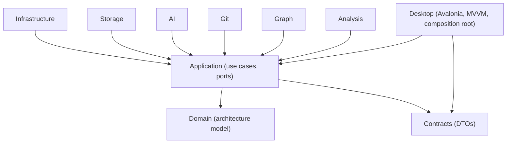

# Codebase Explorer

**See how any codebase is built — visually, locally, with evidence.**

Codebase Explorer is a cross-platform desktop application (Windows, macOS, Linux) that analyzes
software repositories and turns their structure, architecture, dependencies and Git history into an
interactive architecture model. It helps developers understand unfamiliar or complex codebases
quickly — without uploading code and without executing it.

> **Project status: milestones M1 (manual macOS/Linux checks pending), M2 and M3 done; M4 (polyglot analysis and large repositories) in progress.**
> The repository contains the complete product and architecture documentation, a buildable .NET 10
> solution and an application in which a local folder can be imported and its .NET projects analyzed.
> Its project-level dependency graph is shown in the Architecture Explorer (verified on Windows), and the analysis is
> saved in a local SQLite database.
> **There are no Git or AI features yet.** See [Project status](#project-status).

---

## Vision

Developers spend much of their time reconstructing how a system fits together. Codebase Explorer
answers the architectural questions directly:

- How is this repository organized? Which projects and modules exist?
- Which languages and frameworks are used?
- How do components, classes and services depend on each other? Where are the boundaries?
- Which external packages does it rely on? What is tightly coupled?
- What is affected if I change a component? How has the architecture evolved?

Every relationship shown is backed by **evidence** (file, line range, analyzer rule, certainty
level). AI is an optional assistant grounded in these facts — never a replacement for deterministic
analysis. Full vision: [docs/product/VISION.md](docs/product/VISION.md).

## Main features

| Feature | Status |
|---|---|
| App shell: navigation, Start page, Settings (theme System/Light/Dark, remembered across restarts; local data directory), status bar with busy indicator, error notifications, redacted log files in the data directory | ✅ available |
| Architecture Explorer: project-level graph of the imported repository, Component Inspector for a selected node (facts, metrics, members, incoming/outgoing relationships with evidence level, show in graph), evidence (file + line) of a selected edge with a read-only source snippet of the selected evidence (± 5 lines, copy path), light/dark theme | ✅ available (verified on Windows; macOS/Linux not yet tested) |
| Import a local folder (folder picker, progress with stages, cancel) | ✅ available (results are saved locally in SQLite) |
| Recent repositories on the start page: open the stored result without re-analysis, re-analyze, remove all stored data | ✅ available |
| Repository overview: files and lines per language, projects per ecosystem, external dependencies, last run, warnings and errors | ✅ available |
| Run history: every analysis run with status, duration and statistics; its diagnostics (analyzer, file and line) filterable by severity | ✅ available (commit hashes from M5) |
| Clone GitHub/GitLab remotes | ⏳ planned (M5) |
| Repository scanner, language and project detection | 🟡 partial (scanner, .NET and Node projects — `package.json`, npm/yarn/pnpm workspaces, `tsconfig.json` references — available; Python projects — `pyproject.toml` (PEP 621, Poetry), `setup.cfg`, requirement files — available) |
| C# analysis with Roslyn (no build required) | 🟡 partial (namespaces, types and members; inheritance, implementation, type usage, instantiation and calls between them, also across projects, each with evidence; heuristic DI registrations) |
| TypeScript, JavaScript and Python analysis (Tree-sitter, manifests) | ✅ available (basic depth: Node and Python manifests; TypeScript/JavaScript folders, files, top-level declarations and imports — relative, `tsconfig` paths, workspace packages, npm; Python packages, modules, top-level classes/functions and imports — relative, absolute, PyPI with name mapping) |
| Graph layouts (force-directed, hierarchical, concentric; choice remembered) and visual encoding (ecosystem colors, kind shapes, evidence line styles, edge weight, focus dimming) | ✅ available |
| Hierarchical drill-down in the graph: double-click a project or namespace to show its namespaces and types (edges attach to the deepest visible element) | ✅ available (verified on Windows) |
| Node limit for large graphs: at most 500 nodes, the least connected projects collapse into an "N more" node, oversized expansions are refused with a hint | ✅ available |
| Filters (language, ecosystem, relationship kind, evidence level; tests and generated code hidden by default), search with `Ctrl/Cmd+K`, neighborhood view (depth 1–3, direction) with breadcrumbs | ✅ available (tests only; not yet checked manually in the running app) |
| Component Inspector with evidence and source snippets | ⏳ planned (M3) |
| Local persistence (SQLite) and analysis history | 🚧 in progress (M2: database created and migrated at startup; analysis runs and models are saved — reopening a saved repository from the UI follows with REPO-005) |
| Git metadata and change-activity overlays | ⏳ planned (M5) |
| Markdown/Mermaid architecture export | ⏳ planned (M6) |
| Optional local AI (Ollama) with cited answers | ⏳ planned (M7) |

Scope details: [docs/product/MVP_SCOPE.md](docs/product/MVP_SCOPE.md).

## Screenshots

> Screenshots will be added once the Architecture Explorer renders real analysis results (M1).
> Until then no screenshots are published, to avoid showing mock-ups as product features.

| Placeholder | Planned content |
|---|---|
| `docs/assets/screenshot-explorer.png` | Project-level dependency graph |
| `docs/assets/screenshot-inspector.png` | Component Inspector with evidence |

## Principles

- **Visual-first** — the graph is the primary interface.
- **Evidence over assertion** — confirmed, syntactic and heuristic relationships are distinguished.
- **Local-first** — data stays on your machine; cloud AI only after explicit configuration.
- **Never executes repository code** — no builds, restores, scripts or MSBuild evaluation.
- **Universal** — one language-independent model; C#, TypeScript, JavaScript, Python first.
- **Scales** — hierarchical aggregation for monorepos; incremental analysis as a long-term goal.

## Tech stack

| Area | Technology |
|---|---|
| Core | C#, .NET 10, Clean Architecture, modular monolith, DI, async/await |
| Desktop | Avalonia UI 12 (Fluent, light/dark), CommunityToolkit.Mvvm |
| Static analysis | Roslyn (C#, without MSBuild evaluation), Tree-sitter (TS/JS/Python via TreeSitter.DotNet, decided in ANALYSIS-008), manifest parsers |
| Graph | Cytoscape.js, TypeScript, Vite, Avalonia.Controls.WebView (WebView2 verified on Windows; macOS/Linux pending) |
| Storage | SQLite, Entity Framework Core 10, migrations |
| Git | LibGit2Sharp (initial adapter behind an abstraction) |
| AI (optional) | Microsoft.Extensions.AI, Ollama; cloud providers opt-in (post-MVP) |
| Testing | xunit.v3 on Microsoft.Testing.Platform, NSubstitute, fixture repositories |

Only Avalonia, CommunityToolkit.Mvvm, Microsoft.Extensions.* (DI/logging), xunit.v3 and
NSubstitute are referenced today. All other technologies are planned and listed with verification
status in [SOLUTION_STRUCTURE.md §6](docs/architecture/SOLUTION_STRUCTURE.md#6-dependencies).

## Architecture overview



Technical modules implement Application ports and never reference each other; the rules are
enforced by architecture tests. Details: [docs/architecture/SYSTEM_ARCHITECTURE.md](docs/architecture/SYSTEM_ARCHITECTURE.md).

## Project status

| Milestone | Status |
|---|---|
| M0 Foundation — docs, solution, app shell | ✅ done |
| M1 Vertical slice — local repo → .NET projects → project graph | ✅ functionally complete (manual macOS/Linux WebView checks pending) |
| M2 Persistence and analysis runs | ✅ done |
| M3 Deep C# & Inspector | ✅ done |
| M4 Polyglot & scale | 🚧 in progress (see [TASK_BREAKDOWN.md](docs/implementation/TASK_BREAKDOWN.md)) |
| M5 Git · M6 Export · M7 Local AI · M8 Release | ⏳ planned |

What exists today: 10 source projects and 6 test projects, central package management, module
registration seams, a composition root, the Avalonia shell, and the language-independent domain
model (stable IDs, projects, modules, entities, evidence-backed relationships, analysis runs and
model validation; tasks CORE-001 … CORE-004), the application result, error and progress types
(CORE-005), and the first analysis building blocks: safe repository file access, a repository
scanner with `.gitignore` support, and language/project-marker detection (REPO-001 … REPO-004,
including the `dotnet-layered` test fixture), and the analysis pipeline with a static .NET
project-system analyzer that builds the model of .NET repositories — projects, solution folders,
project/package/framework references with evidence — without running MSBuild (ANALYSIS-001 …
ANALYSIS-004), the project-level graph projection with its JSON wire format (GRAPH-002), and the
use cases that tie them together — import a local folder, then query its project graph (CORE-006;
since STORE-004 the analysis results are saved in a local SQLite database). The Start page imports a
local folder with a progress panel and cancel (UI-002). The graph web view (TypeScript + Cytoscape.js, GRAPH-003) is built and
shipped with the app; the host control embeds it in the window (GRAPH-004), and the Architecture Explorer shows the project graph of the imported repository with a selection panel (UI-003, verified on Windows).

## Roadmap

See [docs/product/FEATURE_ROADMAP.md](docs/product/FEATURE_ROADMAP.md) and
[docs/implementation/IMPLEMENTATION_PLAN.md](docs/implementation/IMPLEMENTATION_PLAN.md).
Open product decisions (licensing, SSH, secret storage, …) are tracked in the roadmap.

## Getting started

Prerequisites: .NET SDK 10.0.100 or later 10.0.x (see `global.json`).

```bash
dotnet build CodebaseExplorer.slnx
```

```bash
dotnet test --solution CodebaseExplorer.slnx
```

```bash
dotnet run --project src/CodebaseExplorer.Desktop
```

More: [docs/development/DEVELOPMENT_GUIDE.md](docs/development/DEVELOPMENT_GUIDE.md).

## Documentation

| Area | Documents |
|---|---|
| Product | [Vision](docs/product/VISION.md) · [Concept](docs/product/PRODUCT_CONCEPT.md) · [MVP scope](docs/product/MVP_SCOPE.md) · [Roadmap](docs/product/FEATURE_ROADMAP.md) · [User workflows](docs/product/USER_WORKFLOWS.md) |
| Architecture | [System](docs/architecture/SYSTEM_ARCHITECTURE.md) · [Solution structure](docs/architecture/SOLUTION_STRUCTURE.md) · [Domain model](docs/architecture/DOMAIN_MODEL.md) · [Database](docs/architecture/DATABASE_SCHEMA.md) · [Analysis engine](docs/architecture/ANALYSIS_ENGINE.md) · [Graph engine](docs/architecture/GRAPH_ENGINE.md) · [Git](docs/architecture/GIT_INTEGRATION.md) · [AI](docs/architecture/AI_ARCHITECTURE.md) · [Security](docs/architecture/SECURITY.md) |
| Decisions | [ADR index](docs/decisions/README.md) (ADR-001 … ADR-009) |
| Implementation | [Plan](docs/implementation/IMPLEMENTATION_PLAN.md) · [Milestones](docs/implementation/MILESTONES.md) · [Tasks](docs/implementation/TASK_BREAKDOWN.md) · [Test strategy](docs/implementation/TEST_STRATEGY.md) · [Definition of Done](docs/implementation/DEFINITION_OF_DONE.md) |
| Development | [Guide](docs/development/DEVELOPMENT_GUIDE.md) · [Coding standards](docs/development/CODING_STANDARDS.md) · [Git workflow](docs/development/GIT_WORKFLOW.md) · [AI agent guidelines](docs/development/AI_AGENT_GUIDELINES.md) · [CLAUDE.md](CLAUDE.md) |

## License

Proprietary — all rights reserved (see [LICENSE](LICENSE)). The final licensing model is an open
product decision (OPD-01).
