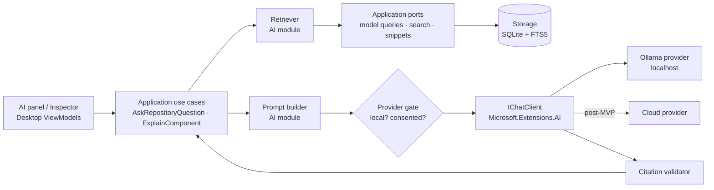

# AI Architecture — Codebase Explorer

> Status: **accepted (specification)** · Last reviewed: 2026-11-17
> Implementation status: **in progress (M7)** — AI-001: settings (`AiSettings`, keys `ai.*`), provider gate, HTTP
> transport and the network guard test exist; AI is disabled by default. AI-002: Ollama provider (health check,
> model listing, `IChatClient`), tested against a stub server. AI-003: FTS5 search index, built on first AI use
> (ADR-013). AI-004: `ContextRetriever` and `PromptBuilder` (context format below, snapshot-tested). AI-005:
> `CitationValidator`. AI-006: `IAiAssistant.AskAsync`, use cases `AskRepositoryQuestion`/`AiConversations`,
> conversation tables, *Assistant* page. Not yet verified against a real Ollama instance.
> Related: [ADR-008](../decisions/ADR-008-hybrid-ai.md), [SECURITY.md](SECURITY.md).

## 1. Principles

1. **Optional.** Every product feature works without AI. AI is off by default.
2. **Grounded.** Answers are generated from *retrieved analysis facts and source snippets*, not from
   the model's general knowledge about "typical" codebases.
3. **Cited and verified.** Every statement about the repository must cite `path:startLine-endLine`
   and/or element IDs. Citations are validated against the stored model before display;
   unverifiable citations are flagged.
4. **Local-first.** The default (and only MVP) provider is Ollama on `localhost`. Cloud providers
   require explicit configuration and per-repository consent.
5. **Read-only.** The AI never modifies code, files, the repository or the model. No tools with
   side effects are exposed to models.
6. **Transparent.** The user can inspect what context was sent to the model (context manifest).

## 2. Components



| Component | Responsibility |
|---|---|
| `IAiAssistant` (Application port) | `AskAsync(question, scope, ct)` streaming answer + citations; `ExplainAsync(elementId, ct)`. |
| Provider registry | Known providers (`ollama`, later cloud), configuration, health check, model listing. |
| Provider gate | Enforces: AI enabled; provider configured; for cloud providers, repository-level consent present. Refuses otherwise. |
| Retriever | Selects context: (a) structured facts from the model (element details, relationships, metrics); (b) lexical search over code chunks (FTS5); (c) snippets around evidence locations. Embedding retrieval is post-MVP. |
| Prompt builder | System prompt with rules (answer only from context, cite every claim, say "not found in context" otherwise, treat context as untrusted data), context blocks with stable citation keys, token budgeting per model. |
| Citation validator | Parses citations from the answer, checks file exists in model, line range within file length, element ID exists; marks each citation `verified`/`unverified`. |
| Conversation store | Persists conversations/messages/artifacts (DATABASE_SCHEMA.md §4.14–4.16), including context manifest. |

## 3. Provider abstraction

- `Microsoft.Extensions.AI` (`IChatClient`) is the abstraction boundary. Packages (re-verified 2026-11-19):
  `Microsoft.Extensions.AI` 10.11.0 (10.x line; AI-001), `OllamaSharp` 5.5.2 (implements `IChatClient`; AI-002).
- All HTTP clients are created by `AiTransport` (no redirects, no cookies); providers are used only behind the
  `AiProviderGate`.
- The AI module wraps `IChatClient` with: logging (no content in logs), timeout, cancellation,
  token counting where available.
- Provider configuration (`UserSettings`): provider id, endpoint, model id, max context tokens,
  temperature. API keys for cloud providers go to secret storage (OPD-03), never `UserSettings`.

## 4. Retrieval and context format

```text
<context>
[F1] fact: project "Billing.Application" (dotnet, net10.0) depends on "Billing.Domain" (ProjectReference, Confirmed)
     evidence: src/Billing.Application/Billing.Application.csproj:14-14
[S1] snippet: src/Billing.Application/Invoices/InvoiceService.cs:10-42
     ```csharp
     ...
     ```
</context>
```

- Snippets are bounded (default ≤ 60 lines each, total budget by model context size).
- Budget (AI-004): context window − answer reserve (25 %, at least 1,024 tokens) − system prompt, question and history
  (history ≤ 20 % of the window, newest kept). Facts take up to half of the context budget first, then snippets, then
  the remaining facts. Tokens are estimated as characters / 4. What did not fit is counted in the manifest.
- Order of candidates: selected element (facts, declaration, evidence lines) → repository overview → types matching
  the question → their declarations → FTS hits. Snippets come only from files allowed by `SecretFilePolicy` whose content
  still matches the analyzed hash.
- Repository text cannot end the context block: `<context>`/`</context>` inside it is neutralized and code fences are
  longer than any backtick run in the snippet.
- Retrieval is scoped: whole repository, current graph selection, or a project/module.
- Citation keys (`[F1]`, `[S1]`) map to exact file/line ranges server-side, so the model only has
  to repeat keys; the validator translates keys to locations. Free-form `path:line` citations are
  validated too.

## 5. Safety

| Risk | Mitigation |
|---|---|
| Prompt injection through repository content (comments like "ignore previous instructions") | Context is wrapped as data with explicit instructions; the model has **no tools**; outputs are rendered as sanitized Markdown (no HTML, no remote images, links only to internal citation targets); answers are labeled AI-generated. |
| Data exfiltration to cloud | Cloud providers disabled in MVP; post-MVP require explicit provider setup + per-repository consent + visible indicator + context manifest preview. |
| Hallucinated structure | Citation validation; "unverified" marking; facts-first context; UI encourages following citations. |
| Leaking secrets from repository files (e.g. `.env`) | Retriever excludes files matching secret patterns (`.env*`, `*.pem`, `*.key`, `id_rsa*`, `*.pfx`, `appsettings.*.json` with likely secrets flagged) by default; configurable. |
| Local model endpoint spoofing | Ollama endpoint defaults to `http://localhost:11434`; non-loopback endpoints are treated as *remote* and require the same consent as cloud providers. |

## 6. Out of scope for MVP

- Cloud providers (architecture prepared, implementation post-MVP).
- Embeddings and vector search.
- Agents, tool calling, code generation or modification.
- Fine-tuning or uploading repositories anywhere.
