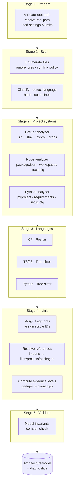

# Analysis Engine — Codebase Explorer

> Status: **accepted (specification)** · Last reviewed: 2026-11-17
> Implementation status: **partially implemented** — pipeline, scanner, .NET project-system analyzer (M1); Roslyn C# declarations (ANALYSIS-005: namespaces → modules, types and members → entities) and their relationships (ANALYSIS-006: Inherits, Implements, UsesType, Instantiates, Calls).
> Related: [ADR-004](../decisions/ADR-004-static-analysis-strategy.md),
> [ADR-007](../decisions/ADR-007-evidence-based-analysis.md),
> [ADR-009](../decisions/ADR-009-incremental-analysis.md), [SECURITY.md](SECURITY.md).

## 1. Responsibilities

The Analysis module turns a repository directory into an `ArchitectureModel`
([DOMAIN_MODEL.md](DOMAIN_MODEL.md)) **without executing anything from the repository**. It owns:

- the repository **scanner** (file enumeration, ignore rules, classification, hashing),
- **project-system analyzers** (.NET, Node, Python manifests),
- **language analyzers** (Roslyn for C#, Tree-sitter for TS/JS/Python),
- the **linker** (merging fragments, resolving references, assigning IDs and evidence levels),
- **safety limits** (size, time, count) and diagnostics.

It implements two Application ports:

- `IRepositoryAnalyzer.AnalyzeAsync(AnalysisRequest, IProgress<AnalysisProgress>, CancellationToken)`: the pipeline.
- `IRepositoryFileReader`: containment-checked, size-limited reading of repository files. Analyzers
  use it internally; Application use cases use it for source snippets (UI-007) and AI context
  (AI-004). It is the only way any module reads repository content.

## 2. Pipeline



Analyzers inside Stage 2 run in parallel (one per ecosystem); analyzers inside Stage 3 run in
parallel per project.

Persistence is not part of the Analysis module: the Application use case passes the resulting
model to the Storage port.

### Stage 0 — Prepare

- Resolve the root to a canonical absolute path; reject device paths, UNC administrative shares,
  file system roots and the app's own data directory.
- Load analysis settings: max file size (default 2 MB for source parsing, files above are recorded
  but not parsed), max files (default 500,000), per-file parse timeout, degree of parallelism
  (default `Environment.ProcessorCount - 1`, min 1).

### Stage 1 — Scan

- Enumerates files depth-first using `System.IO` APIs only.
- **Ignore rules:** built-in excludes (`.git/`, `bin/`, `obj/`, `node_modules/`, `.venv/`,
  `venv/`, `__pycache__/`, `.idea/`, `.vs/`, `dist/`, `build/` — configurable), plus `.gitignore`
  files (gitignore semantics implemented in-process; no `git` invocation). Excluded directories are
  counted in statistics.
- **Symlinks/junctions:** not followed by default; a link pointing outside the root is never
  followed (SECURITY.md).
- **Classification:** by file name/extension and location (`*.Tests` projects, `test/`, `tests/`,
  `__tests__`, `*.spec.ts`, `test_*.py` → `Test`; `*.g.cs`, `*.designer.cs`, files with
  `<auto-generated>` header → `Generated`).
- **Binary detection:** NUL byte in the first 8 KB → `Binary` (not parsed).
- **Hashing:** SHA-256 streamed; basis for incremental analysis.
- Output: `ScannedFile[]` (path, size, hash, language, classification).

**Implementation (REPO-002, `Analysis/Scanning`):** phase 1 enumerates sequentially and applies
excludes, ignore rules and limits; phase 2 inspects files in parallel (`AnalysisLimits.MaxDegreeOfParallelism`)
with one read per file through `IRepositoryFileReader.OpenRead` (SHA-256, line count, NUL-byte
binary check and `<auto-generated` marker in the first 8 KB). Files and diagnostics are sorted, so
the result is independent of parallelism. Built-in exclude names match case-insensitively. Only
`.gitignore` files inside the repository are honored — `.git/info/exclude` and the user's global
excludes are intentionally not read (they are machine-specific, and the analysis must be
reproducible). An unreadable or oversized `.gitignore` produces a warning and its rules are not
applied.

**Languages and markers (REPO-003):** `LanguageDetector` maps well-known file names (e.g.
`Dockerfile`, `.gitignore`), then extensions (case-insensitive), then — only for files without an
extension — the shebang interpreter (`python*`, `node`, `deno`, `sh`/`bash`/`zsh`, `pwsh`) to a
`LanguageId`; anything else is `unknown`, content is never guessed. MSBuild files
(`.csproj`, `.props`, `.slnx` …) are `xml`, `.sln` is `sln`, `.jsx` is `javascript` (the JS
grammar covers JSX). `ProjectMarkerDetector` recognizes `*.sln`, `*.slnx`, `*.csproj`/`*.fsproj`/
`*.vbproj` (case-insensitive) and `package.json`, `pyproject.toml`, `requirements*.txt`,
`setup.cfg`, `setup.py` (exact names). Classification precedence: `Binary` › `Generated` ›
`SolutionFile`/`ProjectManifest` (markers, also inside test folders) › `Test` › by language
(`Source`, `Documentation`, `Configuration`) › `Other`. Measured: 10,000 small files in 2.7 s (Debug
build, Windows, TEST_STRATEGY.md §8).

### Stage 2 — Project-system analyzers

Run in parallel, one per ecosystem, each over the scanned file list.

**.NET (`dotnet.msbuild-static`)**

- Parses `.sln` (text format) and `.slnx` (XML) to find projects and solution folders.
  **Implemented (ANALYSIS-002, `ProjectSystems/DotNet/SolutionParser`):** solution folders are
  normalized to the `.slnx` form (`/src/`, `/src/core/`; `.sln` folder paths are rebuilt from
  `NestedProjects`), so both formats yield identical memberships; only entries ending in a `*proj`
  extension are projects (web sites and solution items are skipped); paths are resolved from the
  solution's directory and entries outside the repository or rooted are reported
  (`dotnet.path-outside-repository`) and skipped; malformed files yield warnings, never exceptions.
- Parses `.csproj` (and detects `.fsproj`/`.vbproj`) as **XML only**. Extracts `Sdk`,
  `TargetFramework(s)`, `OutputType`, `AssemblyName`, `RootNamespace`, `ProjectReference`,
  `PackageReference` (`Version`, `VersionOverride`), `FrameworkReference`.
- **Static property resolution:** imports `Directory.Build.props` and `Directory.Packages.props`
  by walking up the directory tree *within the repository root*, merges simple
  `<PropertyGroup>` properties and `PackageVersion` items, and substitutes `$(Property)` references
  that resolve to literal values. Conditions are evaluated only for a small, safe subset
  (`'$(Prop)' == 'literal'`); anything else is treated as "unknown" and reported as a diagnostic.
  **No MSBuild evaluation, no targets, no property functions, no tasks.**
  **Implemented (ANALYSIS-003, `ProjectSystems/DotNet/ProjectFileParser`):** the *nearest*
  `Directory.Build.props` and `Directory.Packages.props` inside the repository are applied in the
  order props → packages props → project (chained imports via `GetPathOfFileAbove` are property
  functions and therefore not followed); properties are evaluated in a first pass and items in a
  second pass with the final property values, as in MSBuild. Undefined properties are **unknown**,
  not empty (MSBuild would use `""`, but SDK-defined properties are simply not known here); an
  unknown property value is dropped with an `Info` diagnostic, an item whose `Include` or version
  is unknown is skipped with a `Warning`. Conditions support only `'…' == '…'` and `'…' != '…'`
  (case-insensitive); anything else (`and`/`or`, `Exists()`, …) skips the element with a
  `Warning`. Other `<Import>` elements produce `dotnet.msbuild.import-not-evaluated` (`Info`);
  `PackageReference Update` items are ignored. Package versions: `VersionOverride` › central
  `PackageVersion` (when `ManagePackageVersionsCentrally` is true) › `Version` on the reference ›
  unknown (`dotnet.package.version-missing` warning). The legacy MSBuild XML namespace is supported.
- Evidence: `ProjectReference` → `Confirmed` if the referenced file exists, else `Syntactic`
  + warning. `PackageReference` → `Confirmed` (declaration is authoritative for the dependency
  edge; the *version* may be unresolved).
- **Implemented (ANALYSIS-004, `DotNetProjectSystemAnalyzer`):** one `CodeProject` per
  `.csproj`/`.fsproj`/`.vbproj` (name = file name without extension; properties = all statically
  resolved properties plus `Sdk`; also for unparseable project files, which get a diagnostic);
  solution memberships from all `.sln`/`.slnx` files (listed but missing projects → warning).
  A `ProjectReference` to a missing file is kept as `Syntactic` and points to a **placeholder
  project** (kind `Unknown`, identified by the referenced directory, properties
  `resolution=missing` and `referencedPath`) so the unresolved dependency stays visible; a
  placeholder never owns files (convention defined in Domain `ProjectPropertyKeys`); at the repository root no placeholder can be identified, so only the
  warning remains. `PackageReference` → NuGet `ExternalDependency` with attribute `versionSpec`;
  `FrameworkReference` → `DotNetFramework` dependency. Evidence points to the declaring element, also
  when it is declared in a `Directory.Build.props`. The fixture `dotnet-layered` is reproduced
  exactly (`DotNetProjectSystemAnalyzerTests`).

**Node (`node.manifest`)**

- Parses `package.json` (JSON, size-limited): name, version, `dependencies`, `devDependencies`,
  `peerDependencies`, `optionalDependencies`, `workspaces`; detects `pnpm-workspace.yaml`
  (YAML subset parser or a vetted library — decided in ANALYSIS-009).
- Workspace members become projects; dependencies on workspace package names become
  `ProjectReference`; others become `PackageReference` to npm `ExternalDependency`.
- `tsconfig.json` (JSONC): `compilerOptions.baseUrl`, `paths`, `references` (project references).
- **Never** runs npm/yarn/pnpm; lifecycle scripts are only listed as facts (and flagged in the
  security overview).
- **Implemented (ANALYSIS-009, `ProjectSystems/Node`):** one `CodeProject` per `package.json` (name = `name`,
  else the folder name with an `Info`); kind `NodeWorkspaceRoot` if it has `workspaces` (array or yarn's
  `{ packages }`) or a `pnpm-workspace.yaml` beside it, else `NodePackage`; primary language `typescript` if the
  package folder has a `tsconfig.json` or owns `.ts`/`.tsx` files, else `javascript`. Members: packages whose folder
  matches a pattern of the innermost enclosing workspace root (`*`, `**`, `?`, `!` exclusions; `WorkspacePatterns`)
  get the property `workspace`. A dependency whose name is a Node project of the repository becomes a
  `ProjectReference` (any version spec, incl. `workspace:*`), all others npm `PackageReference`s; both `Confirmed`,
  rule `package.json.{dependencyType}`, attributes `dependencyType`, `versionSpec`, `devOnly=true` for
  `devDependencies`; duplicate package names warn and resolve to the first (ordinal path). The project folder's
  `tsconfig.json` adds `ProjectReference`s for its `references` (rule `tsconfig.references`; unresolved → `Warning`),
  except for solution-style configs (`"files": []` without `include`), which only group projects. Properties:
  `version`, `private`, `workspaces`, `workspace`, `scripts`, `lifecycleScripts`, `tsconfig`; each lifecycle script
  (`preinstall`, `install`, `postinstall`, `prepare`, …) gets an `Info` diagnostic
  `node.scripts.lifecycle-not-executed`. JSON/JSONC is read with `Parsing/SafeJson` (`Utf8JsonReader`, depth 64,
  comments and trailing commas allowed, positions in UTF-16 columns, errors as `Warning` diagnostics; the project is
  still created). `pnpm-workspace.yaml` is read by a minimal in-house reader of the `packages:` list
  (`PnpmWorkspaceFile`) — decided instead of a YAML library, which would add aliases/anchors/tags as attack surface
  for one list. `baseUrl`/`paths` (`TsConfigFile`) are used by the TS/JS analyzer (ANALYSIS-010). Oracle: fixtures
  `ts-monorepo-workspaces`, `js-commonjs`, `mixed-polyglot`; zero execution: fixture `node-hostile`
  (`HostileNodeFixtureTests`).

**Python (`python.manifest`)**

- Parses `pyproject.toml` (TOML parser library to be chosen in ANALYSIS-011): `[project]`
  name/dependencies/optional-dependencies, Poetry `[tool.poetry]`, `requires-python`.
- Parses `requirements*.txt` (line format, `-r` includes within the repository only),
  `setup.cfg` (INI). `setup.py` is detected and reported, **never executed**; static extraction
  from `setup.py` is not attempted in the MVP.
- Package roots: directories with `__init__.py`, `src/` layout detection.

### Stage 3 — Language analyzers

Run per project with bounded parallelism. Each analyzer receives only the files of its language
belonging to that project (plus read access to the scanned file list for resolution hints).

**C# (`csharp.roslyn`)** — details in ADR-004 and ADR-011. Runs as a repository-level analyzer
(`IRepositoryLanguageAnalyzer`): it receives all C# projects with the stage-2 project references and
analyzes them in topological order, because a project's compilation references those of its referenced
projects. Failures are isolated per project (`csharp.project.failed`); reference cycles are broken with a
warning (`csharp.project.reference-cycle`).

1. Parse all `.cs` files of the project with `CSharpSyntaxTree.ParseText` (language version preview;
   preprocessor symbols from statically resolved `DefineConstants` where available, plus `NET`,
   `NETCOREAPP`). With `ImplicitUsings=enable` the SDK's default global usings are added as an extra
   tree (Microsoft.NET.Sdk, plus the Web SDK list for `Microsoft.NET.Sdk.Web`). Files that cannot be read
   (size limit, …) are skipped with `csharp.file.not-read`.
2. Create a `CSharpCompilation` with **metadata references only**:
   - the embedded .NET 10 reference assemblies of `Basic.Reference.Assemblies.Net100` — the same on every
     machine, so symbol keys and entity ids do not depend on an installed SDK (ADR-011);
   - compilations of referenced in-repository projects (as `CompilationReference`s, transitive), built in
     topological order;
   - **no NuGet assemblies** (ADR-011): package types remain unresolved everywhere.
   *Implemented:* steps 1–2 and the declarations of step 3 (ANALYSIS-005); relationships of steps 3–4 except
   the DI heuristics (ANALYSIS-006). The analyzer runs in two phases: all projects are compiled and their
   declarations collected (topological order), then relationships are extracted, so the name-based fallback
   sees the types of every project. Only Domain objects leave the analyzer; all compilations are released
   after the run.
3. Walk the semantic model: declared namespaces → `CodeModule`s; types and members →
   `CodeEntity`s; base types (`Inherits`, interfaces → `Implements`), type usages incl. generic arguments
   and constraints (`UsesType`), object creations (`Instantiates`), invocations and constructor initializers
   (`Calls`) →
   relationships between repository entities (generic instantiations target the definition; framework and
   package types produce none; source = innermost declaring member, else type; one evidence per occurrence,
   rules `csharp.<Kind>`).
4. Evidence level: symbol resolved by the semantic model → `Confirmed`; unresolved symbol but
   name (and arity) matching exactly one repository type → `Syntactic` (e.g. missing project reference;
   a single overload candidate the compiler did not pick → `Syntactic` too); patterns (e.g.
   `services.AddScoped<IFoo, Foo>()`) → `Heuristic` (ANALYSIS-007). *Implemented (ANALYSIS-007):*
   `Add|TryAdd{Singleton|Scoped|Transient}<TService, TImpl>()`, `…<TImpl>()` and `…(typeof(TService), typeof(TImpl))`
   → `RegistersService` from the registering member to the implementation with attributes `serviceType` and
   `lifetime`; recognized by shape and name (ADR-011: `IServiceCollection` is never resolved), calls that
   resolve to a repository method are excluded.
5. **Never** load analyzers, source generators or any assembly from the repository or its
   packages for execution. Generated code is therefore invisible (documented limitation).

**TypeScript / JavaScript (`treesitter.typescript`, `treesitter.javascript`)**

- Tree-sitter grammars for TypeScript, TSX, JavaScript (JSX). Extract `import`/`export`
  declarations, `require()` calls with literal arguments, dynamic `import()` with literal
  arguments, top-level classes/functions/interfaces/type aliases.
- Resolution: relative specifiers → files (extension and `index` resolution rules of Node/TS);
  `tsconfig` `paths`/`baseUrl` → files; bare specifiers → workspace package or npm
  `ExternalDependency`.
- Evidence: resolved to existing file → `Confirmed`; bare specifier matched to a declared
  dependency → `Syntactic`; unresolved/computed → `Heuristic` or diagnostic.

**Python (`treesitter.python`)**

- Extract `import x`, `from x import y`, relative imports, top-level classes/functions.
- Resolution against package roots in the repository; otherwise match to declared PyPI
  dependencies (with import-name ↔ distribution-name mapping table for common mismatches, e.g.
  `yaml` ↔ `PyYAML` — heuristic).

**Tree-sitter integration** (decided in spike **ANALYSIS-008**, ADR-004 "Spike result"): `TreeSitter.DotNet`
1.3.0 in-process, wrapped by `Languages/TreeSitter` (`TreeSitterParser`: grammars TypeScript, TSX, JavaScript,
Python loaded once and shared, one parser per parse; `SyntaxWalk`: iterative, cancellable cursor walk). No
per-parse timeout exists in the binding: parse time is bounded by the 2 MB parse limit (≤ ~3.3 s measured on
hostile input); cancellation is checked between files and during walks. Tree-sitter queries are not used
(super-linear on hostile input). Positions are 0-based rows and UTF-16 columns.

### Stage 4 — Link

- Merge fragments by natural key; compute `ElementId`s.
- Attach files to projects (innermost project root).
- Resolve cross-fragment references (e.g. TS import of a workspace package resolves to its project).
- Deduplicate relationships by `(source, kind, target)`; collect evidence; compute `Level` and
  `Occurrences`.
- Derive module containment of entities and the module hierarchy.

### Stage 5 — Validate

- Run `ArchitectureModel` invariant checks (Domain).
- Detect ID collisions (same ID, different natural key) → run fails with diagnostic.
- Compute statistics.

## 3. Analyzer contract

```csharp
// Analysis/Pipeline (internal) — implemented in ANALYSIS-001
internal interface IProjectSystemAnalyzer
{
    AnalyzerDescriptor Descriptor { get; }               // id, version, ecosystem
    bool AppliesTo(ScanResult scan);
    Task<AnalyzerFragment> AnalyzeAsync(ProjectSystemContext context, CancellationToken ct);
}

internal interface ILanguageAnalyzer
{
    AnalyzerDescriptor Descriptor { get; }               // id, version, languages
    bool Supports(LanguageId language);
    Task<AnalyzerFragment> AnalyzeProjectAsync(LanguageAnalysisContext context, CancellationToken ct);
}
```

Rules:

1. Analyzers are **independent**: no analyzer references another analyzer or consumes another
   analyzer's output directly. Cross-analyzer information flows only through the linker.
2. Analyzers are **pure** with respect to the repository: they read through
   `IRepositoryFileReader` (path containment + size limits) and never write.
3. Analyzers return **fragments** (`AnalyzerFragment`: projects, modules, entities, external
   dependencies, relationships with evidence, diagnostics), never persistence entities. Fragment
   elements are Domain objects: since CORE-001 every Domain element derives its id from its natural
   key inside its factory, so a Domain object *is* a natural-key fragment and analyzers cannot
   assign ids inconsistently. (This replaces the original wording "never Domain objects with IDs",
   written before ids became key-derived.) Analyzers reference elements of other analyzers only by
   computing their key-derived ids, never by calling each other.
4. Every relationship in a fragment carries at least one evidence item with rule id and location.
5. Failures are isolated: an exception in an analyzer for one project becomes an `Error`
   diagnostic; the run becomes `PartiallySucceeded`.
6. Analyzers are registered in DI as `IEnumerable<…>`; adding a language = adding an analyzer
   class + registration + fixtures.

**Pipeline implementation (ANALYSIS-001):** `AnalysisPipeline` implements the Application port
`IRepositoryAnalyzer.AnalyzeAsync(AnalysisRequest, IProgress<AnalysisProgress>?, CancellationToken)`
and returns `Result<RepositoryAnalysis>` (model, diagnostics, statistics, analyzer versions); the
calling use case owns the `AnalysisRun`. Project-system analyzers run in parallel, language
analyzers per (analyzer, project) with bounded parallelism; each call is isolated — an exception
becomes an `analysis.analyzer-failed` `Error` diagnostic, cancellation propagates. Analyzers are
ordered by id, so the merge order is deterministic. `ModelLinker` merges elements with the same id
and key, merges relationships with the same id into one relationship with all evidence
(`CodeRelationship.WithEvidence`), keeps elements with the same id but different keys so that
validation reports the collision, and attaches every file to the innermost project root
(placeholder projects for missing references never own files). If `ArchitectureModel.Validate()`
reports violations, the result is the error `analysis.model-invalid`.

## 4. Progress, cancellation and concurrency

- `AnalysisProgress(stage, processed, total, currentItem)` reported at most every 100 ms.
- `CancellationToken` is checked between files and passed into every I/O call; Roslyn and
  Tree-sitter calls receive the token where supported.
- Parallelism via `Parallel.ForEachAsync` with `MaxDegreeOfParallelism` from settings.
- One run per repository at a time (enforced by the Application use case).

## 5. Limits and safety

| Limit | Default | Behavior when exceeded |
|---|---|---|
| File size for parsing | 2 MB | File recorded, not parsed; `Info` diagnostic. |
| Manifest size | 1 MB | Not parsed; `Warning`. |
| Number of files | 500,000 | Scan stops; run `PartiallySucceeded`; `Warning`. |
| Per-file parse time | 5 s (target; depends on parser support) | Parse aborted; `Warning`. |
| Path length / depth | OS limits; depth 64 | Directory skipped; `Warning`. |
| XML parsing | DTD processing prohibited, external entities disabled, max characters limited | Parse error diagnostic. |

## 6. Determinism

The same repository content and analyzer versions must produce the same model (IDs, relationships,
evidence). Enumeration order is sorted (ordinal) before ID assignment and output.
Tests assert determinism by analyzing a fixture twice and comparing models.

## 7. Scaling strategy

- MVP: per-run materialized fragments; projects analyzed in parallel; Roslyn compilations released
  after each project; memory budget 4 GB for 2,000 projects (validated in QA-002).
- Next: streaming persistence of finished project fragments (requires linker redesign to two-phase
  resolution) — triggered only if QA-002 shows the budget is exceeded.

## 8. Incremental analysis (long-term, ADR-009)

1. Compare the new scan with the stored `Files` (hash per path).
2. Changed/added/removed files → affected projects (owner) → dependent projects (reverse
   `ProjectReference` closure) for semantic re-analysis.
3. Re-run project-system analyzers when any manifest changed (cheap).
4. Replace fragments of affected projects; keep the rest; re-link; validate.
5. Stable natural-key IDs make the diff between runs a set operation on IDs.

Prerequisites already fixed in the MVP design: stable IDs, content hashes, per-project fragments,
`LastSeenRunId` columns.

## 9. Known limitations (MVP)

- C# without restore: types from NuGet packages are unresolved unless cached assets exist →
  more `Syntactic` relationships for package types; project-internal relationships are
  unaffected.
- Source-generated code is invisible.
- Complex MSBuild logic (conditions, custom targets, imported SDK props) is approximated.
- TS type-level relationships beyond imports are not analyzed.
- Python dynamic imports and runtime-modified `sys.path` are not resolved.
