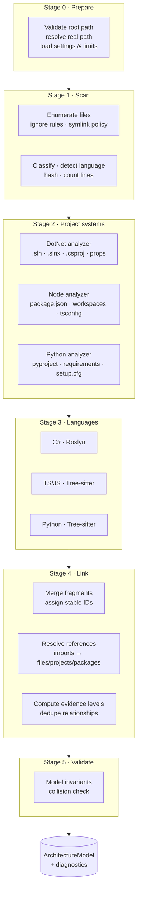

# Analysis Engine — Codebase Explorer

> Status: **accepted (specification)** · Last reviewed: 2026-11-17
> Implementation status: **not implemented** (module seam `AddAnalysisModule()` exists).
> Related: [ADR-004](../decisions/ADR-004-static-analysis-strategy.md),
> [ADR-007](../decisions/ADR-007-evidence-based-analysis.md),
> [ADR-009](../decisions/ADR-009-incremental-analysis.md), [SECURITY.md](SECURITY.md).

## 1. Responsibilities

The Analysis module turns a repository directory into an `ArchitectureModel`
([DOMAIN_MODEL.md](DOMAIN_MODEL.md)) **without executing anything from the repository**. It owns:

- the repository **scanner** (file enumeration, ignore rules, classification, hashing),
- **project-system analyzers** (.NET, Node, Python manifests),
- **language analyzers** (Roslyn for C#, Tree-sitter for TS/JS/Python),
- the **linker** (merging fragments, resolving references, assigning IDs and evidence levels),
- **safety limits** (size, time, count) and diagnostics.

It implements two Application ports:

- `IRepositoryAnalyzer.AnalyzeAsync(AnalysisRequest, IProgress<AnalysisProgress>, CancellationToken)`: the pipeline.
- `IRepositoryFileReader`: containment-checked, size-limited reading of repository files. Analyzers
  use it internally; Application use cases use it for source snippets (UI-007) and AI context
  (AI-004). It is the only way any module reads repository content.

## 2. Pipeline



Analyzers inside Stage 2 run in parallel (one per ecosystem); analyzers inside Stage 3 run in
parallel per project.

Persistence is not part of the Analysis module: the Application use case passes the resulting
model to the Storage port.

### Stage 0 — Prepare

- Resolve the root to a canonical absolute path; reject device paths, UNC administrative shares,
  file system roots and the app's own data directory.
- Load analysis settings: max file size (default 2 MB for source parsing, files above are recorded
  but not parsed), max files (default 500,000), per-file parse timeout, degree of parallelism
  (default `Environment.ProcessorCount - 1`, min 1).

### Stage 1 — Scan

- Enumerates files depth-first using `System.IO` APIs only.
- **Ignore rules:** built-in excludes (`.git/`, `bin/`, `obj/`, `node_modules/`, `.venv/`,
  `venv/`, `__pycache__/`, `.idea/`, `.vs/`, `dist/`, `build/` — configurable), plus `.gitignore`
  files (gitignore semantics implemented in-process; no `git` invocation). Excluded directories are
  counted in statistics.
- **Symlinks/junctions:** not followed by default; a link pointing outside the root is never
  followed (SECURITY.md).
- **Classification:** by file name/extension and location (`*.Tests` projects, `test/`, `tests/`,
  `__tests__`, `*.spec.ts`, `test_*.py` → `Test`; `*.g.cs`, `*.designer.cs`, files with
  `<auto-generated>` header → `Generated`).
- **Binary detection:** NUL byte in the first 8 KB → `Binary` (not parsed).
- **Hashing:** SHA-256 streamed; basis for incremental analysis.
- Output: `ScannedFile[]` (path, size, hash, language, classification).

### Stage 2 — Project-system analyzers

Run in parallel, one per ecosystem, each over the scanned file list.

**.NET (`dotnet.msbuild-static`)**

- Parses `.sln` (text format) and `.slnx` (XML) to find projects and solution folders.
- Parses `.csproj` (and detects `.fsproj`/`.vbproj`) as **XML only**. Extracts `Sdk`,
  `TargetFramework(s)`, `OutputType`, `AssemblyName`, `RootNamespace`, `ProjectReference`,
  `PackageReference` (`Version`, `VersionOverride`), `FrameworkReference`.
- **Static property resolution:** imports `Directory.Build.props` and `Directory.Packages.props`
  by walking up the directory tree *within the repository root*, merges simple
  `<PropertyGroup>` properties and `PackageVersion` items, and substitutes `$(Property)` references
  that resolve to literal values. Conditions are evaluated only for a small, safe subset
  (`'$(Prop)' == 'literal'`); anything else is treated as "unknown" and reported as a diagnostic.
  **No MSBuild evaluation, no targets, no property functions, no tasks.**
- Evidence: `ProjectReference` → `Confirmed` if the referenced file exists, else `Syntactic`
  + warning. `PackageReference` → `Confirmed` (declaration is authoritative for the dependency
  edge; the *version* may be unresolved).

**Node (`node.manifest`)**

- Parses `package.json` (JSON, size-limited): name, version, `dependencies`, `devDependencies`,
  `peerDependencies`, `optionalDependencies`, `workspaces`; detects `pnpm-workspace.yaml`
  (YAML subset parser or a vetted library — decided in ANALYSIS-009).
- Workspace members become projects; dependencies on workspace package names become
  `ProjectReference`; others become `PackageReference` to npm `ExternalDependency`.
- `tsconfig.json` (JSONC): `compilerOptions.baseUrl`, `paths`, `references` (project references).
- **Never** runs npm/yarn/pnpm; lifecycle scripts are only listed as facts (and flagged in the
  security overview).

**Python (`python.manifest`)**

- Parses `pyproject.toml` (TOML parser library to be chosen in ANALYSIS-011): `[project]`
  name/dependencies/optional-dependencies, Poetry `[tool.poetry]`, `requires-python`.
- Parses `requirements*.txt` (line format, `-r` includes within the repository only),
  `setup.cfg` (INI). `setup.py` is detected and reported, **never executed**; static extraction
  from `setup.py` is not attempted in the MVP.
- Package roots: directories with `__init__.py`, `src/` layout detection.

### Stage 3 — Language analyzers

Run per project with bounded parallelism. Each analyzer receives only the files of its language
belonging to that project (plus read access to the scanned file list for resolution hints).

**C# (`csharp.roslyn`)** — details in ADR-004.

1. Parse all `.cs` files of the project with `CSharpSyntaxTree.ParseText` (preprocessor symbols
   from statically resolved `DefineConstants` where available, plus `NET`, `NETCOREAPP`).
2. Create a `CSharpCompilation` with **metadata references only**:
   - reference assemblies of the target framework from the locally installed .NET SDK packs
     (`<dotnet root>/packs/Microsoft.NETCore.App.Ref/<version>/ref/<tfm>/*.dll`) if present —
     read as metadata, never loaded for execution;
   - compilations of referenced in-repository projects (as `CompilationReference`s), built in
     topological order;
   - NuGet packages **only if** they are already present in the local NuGet cache and an
     `obj/project.assets.json` exists (read-only; no restore). Otherwise package types remain
     unresolved.
3. Walk the semantic model: declared namespaces → `CodeModule`s; types and members →
   `CodeEntity`s; base types, interfaces, type usages, object creations, invocations →
   relationships.
4. Evidence level: symbol resolved by the semantic model → `Confirmed`; unresolved symbol but
   syntactic name match to a known in-repository type → `Syntactic`; patterns (e.g.
   `services.AddScoped<IFoo, Foo>()`) → `Heuristic` (ANALYSIS-007).
5. **Never** load analyzers, source generators or any assembly from the repository or its
   packages for execution. Generated code is therefore invisible (documented limitation).

**TypeScript / JavaScript (`treesitter.typescript`, `treesitter.javascript`)**

- Tree-sitter grammars for TypeScript, TSX, JavaScript (JSX). Extract `import`/`export`
  declarations, `require()` calls with literal arguments, dynamic `import()` with literal
  arguments, top-level classes/functions/interfaces/type aliases.
- Resolution: relative specifiers → files (extension and `index` resolution rules of Node/TS);
  `tsconfig` `paths`/`baseUrl` → files; bare specifiers → workspace package or npm
  `ExternalDependency`.
- Evidence: resolved to existing file → `Confirmed`; bare specifier matched to a declared
  dependency → `Syntactic`; unresolved/computed → `Heuristic` or diagnostic.

**Python (`treesitter.python`)**

- Extract `import x`, `from x import y`, relative imports, top-level classes/functions.
- Resolution against package roots in the repository; otherwise match to declared PyPI
  dependencies (with import-name ↔ distribution-name mapping table for common mismatches, e.g.
  `yaml` ↔ `PyYAML` — heuristic).

**Tree-sitter integration** is subject to spike **ANALYSIS-008** (binding package, bundled
grammars, native binaries for all RIDs, robustness against hostile input, timeouts).

### Stage 4 — Link

- Merge fragments by natural key; compute `ElementId`s.
- Attach files to projects (innermost project root).
- Resolve cross-fragment references (e.g. TS import of a workspace package resolves to its project).
- Deduplicate relationships by `(source, kind, target)`; collect evidence; compute `Level` and
  `Occurrences`.
- Derive module containment of entities and the module hierarchy.

### Stage 5 — Validate

- Run `ArchitectureModel` invariant checks (Domain).
- Detect ID collisions (same ID, different natural key) → run fails with diagnostic.
- Compute statistics.

## 3. Analyzer contract

```csharp
// Analysis/Pipeline (internal) — illustrative, finalized in ANALYSIS-001
internal interface IProjectSystemAnalyzer
{
    AnalyzerDescriptor Descriptor { get; }               // id, version, ecosystem
    bool AppliesTo(ScanResult scan);
    Task<AnalyzerFragment> AnalyzeAsync(ProjectSystemContext context, CancellationToken ct);
}

internal interface ILanguageAnalyzer
{
    AnalyzerDescriptor Descriptor { get; }               // id, version, languages
    bool Supports(LanguageId language);
    Task<AnalyzerFragment> AnalyzeProjectAsync(LanguageAnalysisContext context, CancellationToken ct);
}
```

Rules:

1. Analyzers are **independent**: no analyzer references another analyzer or consumes another
   analyzer's output directly. Cross-analyzer information flows only through the linker.
2. Analyzers are **pure** with respect to the repository: they read through
   `IRepositoryFileReader` (path containment + size limits) and never write.
3. Analyzers return **fragments** (natural-key-based elements, relationships with evidence,
   diagnostics), never Domain objects with IDs and never persistence entities.
4. Every relationship in a fragment carries at least one evidence item with rule id and location.
5. Failures are isolated: an exception in an analyzer for one project becomes an `Error`
   diagnostic; the run becomes `PartiallySucceeded`.
6. Analyzers are registered in DI as `IEnumerable<…>`; adding a language = adding an analyzer
   class + registration + fixtures.

## 4. Progress, cancellation and concurrency

- `AnalysisProgress(stage, processed, total, currentItem)` reported at most every 100 ms.
- `CancellationToken` is checked between files and passed into every I/O call; Roslyn and
  Tree-sitter calls receive the token where supported.
- Parallelism via `Parallel.ForEachAsync` with `MaxDegreeOfParallelism` from settings.
- One run per repository at a time (enforced by the Application use case).

## 5. Limits and safety

| Limit | Default | Behavior when exceeded |
|---|---|---|
| File size for parsing | 2 MB | File recorded, not parsed; `Info` diagnostic. |
| Manifest size | 1 MB | Not parsed; `Warning`. |
| Number of files | 500,000 | Scan stops; run `PartiallySucceeded`; `Warning`. |
| Per-file parse time | 5 s (target; depends on parser support) | Parse aborted; `Warning`. |
| Path length / depth | OS limits; depth 64 | Directory skipped; `Warning`. |
| XML parsing | DTD processing prohibited, external entities disabled, max characters limited | Parse error diagnostic. |

## 6. Determinism

The same repository content and analyzer versions must produce the same model (IDs, relationships,
evidence). Enumeration order is sorted (ordinal) before ID assignment and output.
Tests assert determinism by analyzing a fixture twice and comparing models.

## 7. Scaling strategy

- MVP: per-run materialized fragments; projects analyzed in parallel; Roslyn compilations released
  after each project; memory budget 4 GB for 2,000 projects (validated in QA-002).
- Next: streaming persistence of finished project fragments (requires linker redesign to two-phase
  resolution) — triggered only if QA-002 shows the budget is exceeded.

## 8. Incremental analysis (long-term, ADR-009)

1. Compare the new scan with the stored `Files` (hash per path).
2. Changed/added/removed files → affected projects (owner) → dependent projects (reverse
   `ProjectReference` closure) for semantic re-analysis.
3. Re-run project-system analyzers when any manifest changed (cheap).
4. Replace fragments of affected projects; keep the rest; re-link; validate.
5. Stable natural-key IDs make the diff between runs a set operation on IDs.

Prerequisites already fixed in the MVP design: stable IDs, content hashes, per-project fragments,
`LastSeenRunId` columns.

## 9. Known limitations (MVP)

- C# without restore: types from NuGet packages are unresolved unless cached assets exist →
  more `Syntactic` relationships for package types; project-internal relationships are
  unaffected.
- Source-generated code is invisible.
- Complex MSBuild logic (conditions, custom targets, imported SDK props) is approximated.
- TS type-level relationships beyond imports are not analyzed.
- Python dynamic imports and runtime-modified `sys.path` are not resolved.
