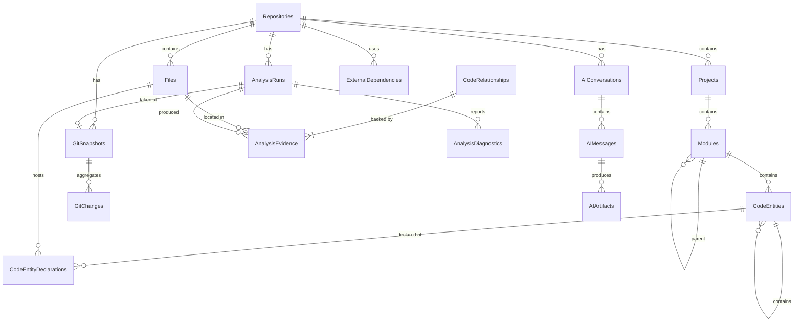

# Database Schema — Codebase Explorer

> Status: **accepted (specification)** · Last reviewed: 2026-11-17
> Implementation status: **model tables implemented** (STORE-001: `Repositories`, `AnalysisRuns`,
> `AnalysisDiagnostics`, `Files`, `Projects`, `Modules`; STORE-002: `CodeEntities`, `CodeEntityDeclarations`,
> `CodeRelationships`, `AnalysisEvidence`, `ExternalDependencies` — DbContext, records, mapping; schema created
> by the startup migration (STORE-003); runs and the current model are written and read by
> `ArchitectureModelStore` (STORE-004); `UserSettings` is read and written by `UserSettingsStore` (STORE-005); `GitSnapshots` and
> `GitChanges` by `GitActivityStore` (GIT-005, migration `AddGitActivity`)). Implemented by STORE-001 … STORE-005 (core and
> settings tables), GIT-005 (Git tables), AI-003 and AI-006 (search index and AI tables) in
> `src/CodebaseExplorer.Storage` using EF Core with the SQLite provider
> ([ADR-005](../decisions/ADR-005-sqlite-storage.md)).

## 1. General conventions

| Topic | Convention |
|---|---|
| Database | One SQLite file per user: `<data>/codebase-explorer.db` (`IApplicationPaths.DatabaseFilePath`). |
| Connection | WAL journal mode, `foreign_keys = ON`, busy timeout 5 s. Set on connection open. |
| Naming | Tables plural PascalCase; columns PascalCase; FK columns `<Target>Id`; indexes `IX_<Table>_<Columns>`. |
| IDs | `RepositoryId`, `AnalysisRunId`: `Guid` (v7). `ElementId`: deterministic 128-bit, stored as `Guid`. **All Guid columns are stored as 16-byte BLOBs** via EF value converters (EF's SQLite default is TEXT; BLOB halves index size for multi-million-row tables). |
| Enums | Stored as `TEXT` (enum name) for readability and safe evolution. |
| Timestamps | `DateTimeOffset` stored as fixed-width `TEXT` ISO-8601 UTC (`yyyy-MM-ddTHH:mm:ss.fffffffZ`, `UtcIsoTextConverter`). **Decided in STORE-001:** EF Core 10 cannot translate `ORDER BY` on `DateTimeOffset` for SQLite; the converter makes the column plain text whose lexicographic order is chronological. The offset is not kept (reads return UTC). |
| JSON | Small dictionaries/lists (properties, statistics) as `TEXT` JSON columns, never queried with JSON functions in hot paths. |
| Ownership | Every top-level model table carries `RepositoryId` to allow cheap per-repository deletion and partitioned queries. Pure child tables reached only through a cascading FK (`CodeEntityDeclarations`, `GitChanges`, `AnalysisDiagnostics`, `AIMessages`) are exempt. |
| Deletes | `ON DELETE CASCADE` from `Repositories` down to all model data. |
| Persistence entities | Separate classes in `Storage/Persistence/Entities` (e.g. `CodeEntityRecord`), mapped to/from Domain types. EF entities never leave the Storage module. |

## 2. Model storage strategy (MVP)

- The **current model** of a repository is stored once (rows for files, projects, modules,
  entities, relationships, evidence, external dependencies). Each row records `LastSeenRunId`.
- A new successful run **replaces** the repository's model inside one transaction
  (delete-and-insert by `RepositoryId`, batched). Run metadata of all runs is kept.
- A failed/cancelled run never touches the current model.
- Architecture history (model per commit) is post-MVP; the schema keeps the door open via
  `LastSeenRunId` and the `GitSnapshots` table (OPD-07, ADR-009).

- **Insert order (found in STORE-001):** `Files.ProjectId` ↔ `Projects.ProjectFileId` and
  `Repositories.LastAnalysisRunId` ↔ `AnalysisRuns.RepositoryId` reference each other. A model is written
  repository → run → files (without project) → projects → file-project links, modules, entities with
  declarations, external dependencies, relationships with evidence → current run of
  the repository; EF cannot save both sides of such a cycle in one step.

## 3. Entity-relationship overview

## 4. Tables

Legend: **PK** primary key, **FK** foreign key, **NN** not null, **UQ** unique.

### 4.1 Repositories

| Column | Type | Constraints | Notes |
|---|---|---|---|
| Id | BLOB(16) | PK | `RepositoryId` |
| Name | TEXT | NN | |
| LocalPath | TEXT | NN, UQ | Absolute, normalized. |
| RemoteUrl | TEXT | | Sanitized (no credentials). |
| SourceKind | TEXT | NN | `RepositorySourceKind` |
| AddedAt | TEXT | NN | |
| LastOpenedAt | TEXT | | For "recent repositories"; set when a repository is opened or successfully imported (REPO-005). |
| LastAnalysisRunId | BLOB(16) | FK → AnalysisRuns.Id (SET NULL) | Current model's run. |

Indexes: `UX_Repositories_LocalPath`, `IX_Repositories_LastOpenedAt`.

### 4.2 AnalysisRuns

| Column | Type | Constraints | Notes |
|---|---|---|---|
| Id | BLOB(16) | PK | |
| RepositoryId | BLOB(16) | FK → Repositories (CASCADE), NN | |
| Status | TEXT | NN | |
| Trigger | TEXT | NN | |
| StartedAt / CompletedAt | TEXT | NN / null | |
| CommitSha / Branch | TEXT | | |
| AnalyzerVersionsJson | TEXT | NN | |
| StatisticsJson | TEXT | NN | |

Indexes: `IX_AnalysisRuns_RepositoryId_StartedAt`.

### 4.3 AnalysisDiagnostics *(addition — required to store per-run warnings/errors without bloating `AnalysisRuns`)*

| Column | Type | Constraints |
|---|---|---|
| Id | INTEGER | PK autoincrement |
| AnalysisRunId | BLOB(16) | FK → AnalysisRuns (CASCADE), NN |
| Severity | TEXT | NN |
| Code | TEXT | NN |
| Message | TEXT | NN |
| AnalyzerId | TEXT | |
| FileId | BLOB(16) | (no FK; file may not exist in the current model) |
| StartLine / StartColumn / EndLine / EndColumn | INTEGER | | 
| Ordinal | INTEGER | NN — report order within the run (added in STORE-001, like the columns, so diagnostics round-trip exactly) |

Index: `IX_AnalysisDiagnostics_AnalysisRunId_Severity`.

### 4.4 Files

| Column | Type | Constraints | Notes |
|---|---|---|---|
| Id | BLOB(16) | PK | `ElementId` |
| RepositoryId | BLOB(16) | FK → Repositories (CASCADE), NN | |
| RelativePath | TEXT | NN | |
| NaturalKey | TEXT | NN | Collision detection. |
| Language | TEXT | NN | |
| Classification | TEXT | NN | |
| SizeBytes | INTEGER | NN | |
| LineCount | INTEGER | | |
| ContentHash | BLOB(32) | NN | |
| ProjectId | BLOB(16) | FK → Projects (SET NULL) | |
| LastSeenRunId | BLOB(16) | NN | |

Indexes: `UX_Files_RepositoryId_RelativePath`, `IX_Files_ProjectId`, `IX_Files_RepositoryId_Language`.

### 4.5 Projects

| Column | Type | Constraints |
|---|---|---|
| Id | BLOB(16) | PK |
| RepositoryId | BLOB(16) | FK → Repositories (CASCADE), NN |
| Name | TEXT | NN |
| NaturalKey | TEXT | NN |
| Kind | TEXT | NN |
| Ecosystem | TEXT | NN |
| PrimaryLanguage | TEXT | NN |
| ProjectFileId | BLOB(16) | FK → Files (SET NULL) |
| RootDirectory | TEXT | NN |
| PropertiesJson | TEXT | NN |
| SolutionMembershipsJson | TEXT | NN |
| LastSeenRunId | BLOB(16) | NN |

Indexes: `IX_Projects_RepositoryId_Ecosystem`, `IX_Projects_RepositoryId_Name`.

### 4.6 Modules

| Column | Type | Constraints |
|---|---|---|
| Id | BLOB(16) | PK |
| RepositoryId | BLOB(16) | FK → Repositories (CASCADE), NN |
| ProjectId | BLOB(16) | FK → Projects (CASCADE), NN |
| ParentModuleId | BLOB(16) | FK → Modules (CASCADE) |
| Name / QualifiedName | TEXT | NN |
| NaturalKey | TEXT | NN |
| Kind | TEXT | NN |
| LastSeenRunId | BLOB(16) | NN |

Indexes: `IX_Modules_ProjectId`, `IX_Modules_ParentModuleId`, `IX_Modules_RepositoryId_QualifiedName`.

### 4.7 CodeEntities

| Column | Type | Constraints |
|---|---|---|
| Id | BLOB(16) | PK |
| RepositoryId | BLOB(16) | FK → Repositories (CASCADE), NN |
| ProjectId | BLOB(16) | FK → Projects (CASCADE), NN |
| ModuleId | BLOB(16) | FK → Modules (CASCADE), NN |
| ContainingEntityId | BLOB(16) | FK → CodeEntities (CASCADE) |
| Name / QualifiedName | TEXT | NN |
| NaturalKey | TEXT | NN |
| SymbolKey | TEXT | NN — language-specific symbol key the id is derived from (*addition in STORE-002*: needed to rebuild the entity) |
| Kind | TEXT | NN |
| Language | TEXT | NN |
| Visibility | TEXT | NN |
| Modifiers | INTEGER | NN (flags) |
| Signature | TEXT | |
| LineCount / MemberCount | INTEGER | |
| LastSeenRunId | BLOB(16) | NN |

Indexes: `IX_CodeEntities_ModuleId`, `IX_CodeEntities_ContainingEntityId`,
`IX_CodeEntities_RepositoryId_Name` (search), `IX_CodeEntities_ProjectId_Kind`.

### 4.8 CodeEntityDeclarations *(addition — an entity can have several declarations, e.g. C# partial types)*

| Column | Type | Constraints |
|---|---|---|
| EntityId | BLOB(16) | PK part, FK → CodeEntities (CASCADE) |
| Ordinal | INTEGER | PK part |
| FileId | BLOB(16) | FK → Files (CASCADE), NN |
| StartLine / StartColumn / EndLine / EndColumn | INTEGER | NN |

Index: `IX_CodeEntityDeclarations_FileId`.

### 4.9 CodeRelationships

| Column | Type | Constraints | Notes |
|---|---|---|---|
| Id | BLOB(16) | PK | |
| RepositoryId | BLOB(16) | FK → Repositories (CASCADE), NN | |
| SourceKind / SourceId | TEXT / BLOB(16) | NN | Polymorphic endpoint (`ElementKind`). |
| TargetKind / TargetId | TEXT / BLOB(16) | NN | |
| Kind | TEXT | NN | `RelationshipKind` |
| Level | TEXT | NN | Max evidence level. |
| LevelRank | INTEGER | NN | 1–3, for range filters. |
| Occurrences | INTEGER | NN | |
| OriginAnalyzer | TEXT | NN | |
| AttributesJson | TEXT | | e.g. package version spec, dev-only flag. |
| SourceProjectId / TargetProjectId | BLOB(16) | | Denormalized container IDs for fast aggregation. |
| SourceModuleId / TargetModuleId | BLOB(16) | | Denormalized container IDs. |
| LastSeenRunId | BLOB(16) | NN | |

**No FKs on polymorphic endpoints** (SQLite cannot express them). Integrity is guaranteed by the
Domain `ArchitectureModel` validation before persisting and verified by Storage tests.

Indexes: `IX_CodeRelationships_SourceId`, `IX_CodeRelationships_TargetId`,
`IX_CodeRelationships_RepositoryId_Kind_LevelRank`,
`IX_CodeRelationships_SourceProjectId_TargetProjectId`,
`IX_CodeRelationships_SourceModuleId_TargetModuleId`.

### 4.10 AnalysisEvidence

| Column | Type | Constraints |
|---|---|---|
| Id | BLOB(16) | PK |
| RepositoryId | BLOB(16) | FK → Repositories (CASCADE), NN |
| RelationshipId | BLOB(16) | FK → CodeRelationships (CASCADE), NN |
| AnalysisRunId | BLOB(16) | FK → AnalysisRuns (CASCADE), NN |
| AnalyzerId / AnalyzerVersion | TEXT | NN |
| Level | TEXT | NN |
| Rule | TEXT | NN |
| FileId | BLOB(16) | FK → Files (CASCADE) |
| StartLine / StartColumn / EndLine / EndColumn | INTEGER | |
| Excerpt | TEXT | ≤ 240 chars |

Indexes: `IX_AnalysisEvidence_RelationshipId`, `IX_AnalysisEvidence_FileId`.

**Evidence sampling (ADR-007, decided in STORE-002): none.** Every evidence record is stored and
`CodeRelationships.Occurrences` equals the number of stored records (checked on read). Current analyzers
emit one record per manifest relationship; sampling is reconsidered with the QA-002 benchmarks before
code-level analysis (M3) produces high-occurrence relationships.

### 4.11 ExternalDependencies

| Column | Type | Constraints |
|---|---|---|
| Id | BLOB(16) | PK |
| RepositoryId | BLOB(16) | FK → Repositories (CASCADE), NN |
| Ecosystem | TEXT | NN |
| Name | TEXT | NN (normalized) |
| DisplayName | TEXT | NN |
| NaturalKey | TEXT | NN |
| LastSeenRunId | BLOB(16) | NN |

Index: `UX_ExternalDependencies_RepositoryId_Ecosystem_Name`.

### 4.12 GitSnapshots

Git state at the time of an analysis run.

| Column | Type | Constraints |
|---|---|---|
| Id | BLOB(16) | PK |
| RepositoryId | BLOB(16) | FK → Repositories (CASCADE), NN |
| AnalysisRunId | BLOB(16) | FK → AnalysisRuns (CASCADE), UQ |
| HeadCommitSha | TEXT | NN |
| Branch | TEXT | |
| IsDetachedHead | INTEGER | NN |
| HasUncommittedChanges | INTEGER | NN |
| RemotesJson | TEXT | NN (sanitized URLs) |
| HistoryDepth | INTEGER | NN — number of commits scanned |
| HistoryWindowStart | TEXT | Oldest commit date scanned |
| CapturedAt | TEXT | NN |

Indexes: `IX_GitSnapshots_RepositoryId_CapturedAt`, `UX_GitSnapshots_AnalysisRunId` (the UQ constraint). *Implemented in GIT-005*
(`IGitActivityStore`, `GitActivityStore`): written right after the run's model, only for repositories with a HEAD commit;
`RemotesJson` is a JSON array of `{ name, url }` with sanitized URLs.

### 4.13 GitChanges

Per-file change statistics within the snapshot's history window (aggregated, not per commit).

| Column | Type | Constraints |
|---|---|---|
| GitSnapshotId | BLOB(16) | PK part, FK → GitSnapshots (CASCADE) |
| FileId | BLOB(16) | PK part, FK → Files (CASCADE) |
| CommitCount | INTEGER | NN |
| DistinctAuthorCount | INTEGER | NN |
| LinesAdded / LinesDeleted | INTEGER | |
| FirstCommitAt / LastCommitAt | TEXT | |
| LastCommitSha | TEXT | |

Author identities are **not stored** in the MVP (only counts) to minimize personal data.
Index: `IX_GitChanges_FileId`. *Implemented in GIT-005:* rows exist only for files of the run's model with at least one
commit in the window (paths are matched to `Files.RelativePath`; other paths are dropped). Because `FileId` cascades,
replacing a model deletes the statistics of the previous snapshot — only the current run keeps per-file numbers.

### 4.14 AIConversations

| Column | Type | Constraints |
|---|---|---|
| Id | BLOB(16) | PK |
| RepositoryId | BLOB(16) | FK → Repositories (CASCADE), NN |
| Title | TEXT | NN |
| ProviderId / ModelId | TEXT | NN |
| IsCloudProvider | INTEGER | NN |
| CreatedAt / UpdatedAt | TEXT | NN |

Index: `IX_AIConversations_RepositoryId_UpdatedAt`.

### 4.15 AIMessages

| Column | Type | Constraints |
|---|---|---|
| Id | BLOB(16) | PK |
| ConversationId | BLOB(16) | FK → AIConversations (CASCADE), NN |
| Ordinal | INTEGER | NN |
| Role | TEXT | NN (`User`, `Assistant`, `System`) |
| Content | TEXT | NN |
| CitationsJson | TEXT | Validated citations (file id, lines, element id, verified flag). |
| ContextManifestJson | TEXT | Which facts/snippets were sent to the model (transparency). |
| PromptTokens / CompletionTokens | INTEGER | |
| CreatedAt | TEXT | NN |

Index: `UX_AIMessages_ConversationId_Ordinal`.

### 4.16 AIArtifacts

Reusable AI outputs attached to model elements (e.g. cached component explanations).

| Column | Type | Constraints |
|---|---|---|
| Id | BLOB(16) | PK |
| RepositoryId | BLOB(16) | FK → Repositories (CASCADE), NN |
| MessageId | BLOB(16) | FK → AIMessages (SET NULL) |
| ElementKind / ElementId | TEXT / BLOB(16) | NN (polymorphic) |
| ArtifactKind | TEXT | NN (`ComponentExplanation`, `Summary`) |
| Content | TEXT | NN |
| AnalysisRunId | BLOB(16) | NN — invalidated when the model changes. |
| CreatedAt | TEXT | NN |

Index: `IX_AIArtifacts_ElementId_ArtifactKind`.

### 4.17 UserSettings

| Column | Type | Constraints |
|---|---|---|
| Key | TEXT | PK (e.g. `appearance.theme`, `ai.provider`) |
| ValueJson | TEXT | NN |
| UpdatedAt | TEXT | NN |

Secrets (tokens, API keys) are **never** stored here (OPD-03).

*Implemented in STORE-005* (port `IUserSettingsStore`, `UserSettingsStore`, migration `AddUserSettings`).
Each value is a JSON string; a row whose `ValueJson` is not a JSON string reads as missing. Keys in use
(constants in `UserSettingKeys`; add every new key here):

| Key | Values | Missing / unknown value | Used by |
|---|---|---|---|
| `appearance.theme` | `"system"`, `"light"`, `"dark"` | `system` | `ThemeService` (Desktop): restored before the main window is shown, written when the user changes the theme. |
| `graph.layout` | `"force"`, `"hierarchical"`, `"concentric"` | `force` | `ArchitectureExplorerPageViewModel` (Desktop, GRAPH-005): restored at startup and sent to the graph view before any graph, written when the user switches the layout. |

### 4.18 Search index (AI retrieval, M7)

`SearchChunks` — an FTS5 virtual table (`ChunkId`, `RepositoryId`, `FileId`, `StartLine`,
`EndLine`, `Text`) for lexical retrieval. Created by a raw-SQL migration. **Pending verification**
that the SQLite library bundled with the EF Core SQLite provider includes FTS5 (task AI-003).

## 5. Migrations

- EF Core migrations live in `src/CodebaseExplorer.Storage/Migrations`; a design-time
  `IDesignTimeDbContextFactory` provides a context for `dotnet ef` without the Desktop project.
- The app applies pending migrations at startup (`Database.MigrateAsync`) **before** any UI that
  reads data; a failed migration shows an error page (message, database file, backup folder) and does not
  delete or change data. *Implemented in STORE-003* (`IDatabaseInitializer`, `DatabaseInitializer`,
  `StartupErrorWindow`, which also shows the log directory since CORE-007).
- Before migrating an existing database file, the app backs it up with SQLite's online backup API (a
  plain file copy would miss changes still in the `-wal` file) to
  `<data>/backups/codebase-explorer-<yyyyMMdd-HHmmss-fff>.db` (UTC; keep last 3). The data and backup
  directories are created with mode 0700 on Unix and the database files are set to 0600 after opening; on
  Windows the per-user profile ACL applies. (Pre-creating an empty database file to set its mode makes the
  EF Core SQLite migrator fail, found in STORE-003.)
- Tests run every schema check against a database created by the migrations, and `HasPendingModelChanges`
  fails a Storage test when the model changed without a migration.
- Migrations are forward-only in production; down-migrations are not supported.
- Every migration is covered by a Storage test that migrates an empty database to the latest
  version and, for data migrations, a test with a seeded database of the previous version.
- Analysis data is **re-creatable** (it can be re-analyzed); user data (repositories list,
  settings, AI conversations) is not and must be preserved by every migration.

## 6. Performance considerations

- Bulk inserts with batching (EF Core `AddRange` + `SaveChanges` per batch of ~5,000 rows, change
  tracking disabled for read paths; raw `SqliteCommand` with prepared statements is the fallback if
  measurements in QA-002 show EF batching is insufficient).
- Read paths for the graph use projections to DTO-like records (`AsNoTracking`, `Select`), never
  load entity graphs.
- Denormalized project/module IDs on relationships make project- and module-level aggregation a
  single indexed `GROUP BY`.
- `VACUUM`/`ANALYZE` offered as maintenance action, not automatic.
