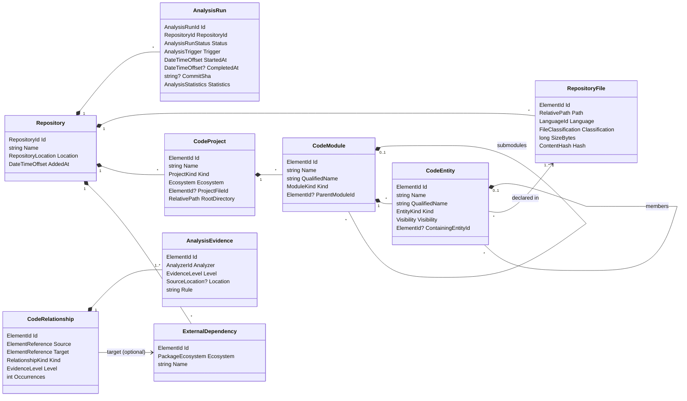

# Domain Model — Codebase Explorer

> Status: **accepted (specification)** · Last reviewed: 2026-11-17
> Implementation status: **implemented** in `src/CodebaseExplorer.Domain` (CORE-001 … CORE-004),
> covered by `tests/CodebaseExplorer.Domain.Tests`. No analyzer produces the model yet.

The domain model is the **language-independent architecture model** that every analyzer produces
and every consumer (graph, inspector, export, AI) reads
([ADR-003](../decisions/ADR-003-language-independent-domain-model.md)).

## 1. Design principles

1. **Language-independent core, language-specific detail as data.** Kinds are generic
   (`Type`, `Function`, `Module`); language specifics go into `Language`, `Ecosystem`, `Kind`
   sub-classification and an attribute bag — never into new domain classes per language.
2. **Containment is structure; relationships are dependencies.** `Repository ⊃ CodeProject ⊃
   CodeModule ⊃ CodeEntity` is a containment tree expressed by parent references. Dependencies
   between elements are `CodeRelationship`s.
3. **Every relationship has an origin and evidence** ([ADR-007](../decisions/ADR-007-evidence-based-analysis.md)).
4. **Stable identities.** IDs are deterministic functions of natural keys, so the same element gets
   the same ID across analysis runs (required for incremental analysis, history comparison, UI
   state and AI citations).
5. **No infrastructure in the domain.** No EF attributes, no JSON attributes, no Roslyn/Tree-sitter
   types. Plain C# with invariants enforced in constructors/factories.
6. **Immutable after analysis.** Model elements are created by analysis and treated as read-only
   afterwards; a new analysis run produces new state.

## 2. Overview



## 3. Identity

### 3.1 ID types

| Type | Representation | Generation |
|---|---|---|
| `RepositoryId` | `Guid` (random, v7 for time ordering) | Created once when the user adds a repository. Identity of the *registration*, not of the content. |
| `AnalysisRunId` | `Guid` (v7) | Created per run. |
| `ElementId` | 128-bit value, rendered as 32 lowercase hex characters; stored as `Guid` bytes | **Deterministic**: first 16 bytes of `SHA-256(UTF-8(naturalKey))`. Used for files, projects, modules, entities, relationships, evidence and external dependencies. |

Each ID type is a `readonly record struct` wrapping its value, to prevent mixing IDs of different
kinds at compile time.

### 3.2 Natural keys (stable across runs)

The natural key is a canonical string; it is stored alongside the ID for debugging and collision
detection.

| Element | Natural key format | Example |
|---|---|---|
| RepositoryFile | `file:{repositoryId}:{relativePath}` | `file:5f…:src/Billing/Invoice.cs` |
| CodeProject | `project:{repositoryId}:{ecosystem}:{projectFileOrRootPath}` | `project:5f…:dotnet:src/Billing/Billing.csproj` |
| CodeModule | `module:{projectKey}:{moduleKind}:{qualifiedName}` | `module:…:namespace:Billing.Invoices` |
| CodeEntity | `entity:{projectKey}:{language}:{symbolKey}` | `entity:…:csharp:T:Billing.Invoices.InvoiceService` |
| ExternalDependency | `extdep:{repositoryId}:{packageEcosystem}:{normalizedName}` | `extdep:5f…:nuget:serilog` |
| CodeRelationship | `rel:{sourceId}:{kind}:{targetId}` | `rel:ab12…:inherits:cd34…` |
| AnalysisEvidence | `evidence:{relationshipId}:{analyzerId}:{rule}:{fileId}:{startLine}:{startColumn}`; location-less evidence uses `-:0:0` for the last three parts | `evidence:ab12…:dotnet.msbuild-static:csproj.ProjectReference:9f3e…:12:5` |

**Symbol keys per language** (`symbolKey`):

- **C#:** Roslyn documentation comment ID (`T:Ns.Type`, `M:Ns.Type.Method(System.String)`,
  `P:…`, `F:…`, `E:…`). Partial types produce one entity with several declaration locations.
- **TypeScript/JavaScript:** `{moduleRelativePath}#{exportPath}`, e.g.
  `src/billing/invoice.ts#InvoiceService.create`; non-exported top-level symbols use `~` prefix.
- **Python:** `{dottedModulePath}:{qualname}`, e.g. `billing.invoices:InvoiceService.create`.

**Normalization rules** (implemented in `Domain/Common/NaturalKey.cs`): relative paths use `/`,
no leading `./`, no empty segments, case preserved; `%` and `:` inside paths are escaped as `%25` and
`%3A`, because a project key (ending in a path) is embedded in module and entity keys and must not be
confused with the `:` separator. Kind tokens (ecosystem, module kind, language, relationship kind,
analyzer id) must match `[a-z0-9.+-]+`; rule ids must not contain `:` or whitespace; no component may
contain line breaks. Package names: `nuget` and `dotnet-framework` lower-cased, `pypi` normalized per
PEP 503 (runs of `-`, `_`, `.` → `-`, lower-cased), `npm` and others kept as published (trimmed).

**Kind tokens** used inside keys are fixed per enum value (`Domain/Common/KindTokens.cs`) and are
independent of enum member names, because changing a token changes element ids:

| Enum | Tokens |
|---|---|
| `Ecosystem` | `dotnet`, `node`, `python`, `other` |
| `ModuleKind` | `namespace`, `directory`, `package`, `file` (for `FileModule`) |
| `PackageEcosystem` | `nuget`, `npm`, `pypi`, `dotnet-framework`, `unknown` |
| `RelationshipKind` | `project-reference`, `package-reference`, `framework-reference`, `imports`, `inherits`, `implements`, `uses-type`, `instantiates`, `calls`, `registers-service`, `depends-on` |

Domain elements derive `Id` and `NaturalKey` themselves in their factory methods; callers never
pass ids for files, projects, modules, entities, external dependencies, relationships or evidence,
so an id cannot drift from its key. Because evidence keys contain the relationship id, evidence is
created against `CodeRelationship.IdFor(source, kind, target)` and then passed to
`CodeRelationship.Create`, which rejects evidence that belongs to another relationship.

**Consequences:** renaming/moving a file or symbol produces a new ID (by design — it *is* a
different natural key). Rename detection is a post-MVP concern of incremental analysis/history
(ADR-009). Hash collisions are detected when persisting (same ID, different natural key) and fail
the run with a diagnostic.

## 4. Entities and value objects

### 4.1 Repository

The registered repository. Aggregate root for everything below.

| Property | Type | Notes |
|---|---|---|
| `Id` | `RepositoryId` | |
| `Name` | `string` | Display name; defaults to folder name or `owner/repo`. |
| `Location` | `RepositoryLocation` | `LocalPath` (absolute, normalized), `RemoteUrl?` (sanitized — never contains credentials), `SourceKind`. |
| `AddedAt` | `DateTimeOffset` | |
| `LastAnalysisRunId` | `AnalysisRunId?` | The run whose model is current. |

`RepositorySourceKind`: `Local`, `GitHub`, `GitLab`, `OtherGitRemote`.

### 4.2 AnalysisRun

One execution of the analysis pipeline.

| Property | Type | Notes |
|---|---|---|
| `Id`, `RepositoryId` | | |
| `Status` | `AnalysisRunStatus` | `Pending`, `Running`, `Succeeded`, `PartiallySucceeded`, `Failed`, `Cancelled` |
| `Trigger` | `AnalysisTrigger` | `Initial`, `Manual`, `Incremental` (post-MVP) |
| `StartedAt`, `CompletedAt` | `DateTimeOffset` | |
| `CommitSha`, `Branch` | `string?` | From Git metadata if available. |
| `AnalyzerVersions` | `IReadOnlyDictionary<string, string>` | Analyzer id → version, for reproducibility. |
| `Statistics` | `AnalysisStatistics` | Files scanned/skipped, projects, entities, relationships by level, duration per stage. |
| `Diagnostics` | `IReadOnlyList<AnalysisDiagnostic>` | Severity (`Info`/`Warning`/`Error`), code, message, optional location, analyzer. |

State machine: `Pending → Running → (Succeeded | PartiallySucceeded | Failed | Cancelled)`; a
pending run may also fail or be cancelled; terminal states are final. `StartedAt` is the request
time. Completing a running run yields `PartiallySucceeded` exactly when an `Error` diagnostic was
reported, otherwise `Succeeded`; `Failed` requires at least one `Error` diagnostic. Only runs that
produced a model (`Succeeded`, `PartiallySucceeded`) can become `Repository.LastAnalysisRunId`
(`Repository.MarkAnalyzed`). `CommitSha` must be a full SHA-1 or SHA-256 id.

### 4.3 RepositoryFile

| Property | Type | Notes |
|---|---|---|
| `Id` | `ElementId` | From natural key. |
| `Path` | `RelativePath` | Value object; guarantees normalized relative path inside the repository. |
| `Language` | `LanguageId` | Value object (string-based, e.g. `csharp`, `typescript`, `tsx`, `javascript`, `python`, `json`, `xml`, `markdown`, `unknown`) — extensible without enum changes. |
| `Classification` | `FileClassification` | `Source`, `Test`, `ProjectManifest`, `SolutionFile`, `Configuration`, `Documentation`, `Generated`, `Binary`, `Other` |
| `SizeBytes` | `long` | |
| `Hash` | `ContentHash` | SHA-256 of raw bytes (basis for incremental analysis). |
| `ProjectId` | `ElementId?` | Owning project (innermost project root containing the file). |
| `LineCount` | `int?` | For text files. |

### 4.4 CodeProject

A unit of build/packaging: .NET project, npm package, Python project/distribution.

| Property | Type | Notes |
|---|---|---|
| `Id`, `Name` | | |
| `Kind` | `ProjectKind` | `DotNetProject`, `NodePackage`, `NodeWorkspaceRoot`, `PythonProject`, `PythonPackageFolder`, `Unknown` |
| `Ecosystem` | `Ecosystem` | `DotNet`, `Node`, `Python`, `Other` |
| `PrimaryLanguage` | `LanguageId` | |
| `ProjectFileId` | `ElementId?` | Manifest file (`.csproj`, `package.json`, `pyproject.toml`). |
| `RootDirectory` | `RelativePath` | |
| `Properties` | `IReadOnlyDictionary<string,string>` | Ecosystem-specific facts: target frameworks, output type, SDK, package version, Python requires … |
| `SolutionMemberships` | `IReadOnlyList<SolutionMembership>` | For .NET: `(SolutionFileId, SolutionFolderPath?)` for every `.sln`/`.slnx` that includes the project. |

**Placeholder projects:** a reference to a project file that does not exist is kept visible as a
`CodeProject` with `Kind = Unknown`, no manifest, `RootDirectory` = the referenced directory and
properties `resolution=missing` / `referencedPath` (ANALYSIS_ENGINE.md Stage 2; keys and the
`IsPlaceholder()` extension in `Domain/Projects/ProjectPropertyKeys`, shared by all modules).
Placeholders never own files.

**Identity:** the natural key uses the manifest path (`ProjectFilePath`) if present, otherwise the
root directory. A project at the repository root therefore needs a manifest; the manifest must lie
within `RootDirectory`. `ProjectFileId` is derived from `ProjectFilePath` (same rule as
`RepositoryFile` ids), so it always matches the manifest's file id.

**Decision:** solutions are *not* modeled as projects and solution membership is *not* a
relationship. A solution is a grouping, not a dependency; modeling it as an edge would pollute
dependency metrics. Solution files are `RepositoryFile`s with `Classification = SolutionFile`, and
the graph uses `SolutionMemberships` for optional grouping. npm/yarn/pnpm workspaces are handled the
same way via the `NodeWorkspaceRoot` project and the `workspace` property of member packages.

### 4.5 CodeModule

A logical grouping below a project: C# namespace, TS/JS directory module, Python package.

| Property | Type | Notes |
|---|---|---|
| `Id`, `Name`, `QualifiedName` | | `QualifiedName` e.g. `Billing.Invoices`, `src/billing`, `billing.invoices` |
| `Kind` | `ModuleKind` | `Namespace`, `Directory`, `Package`, `FileModule` |
| `ProjectId` | `ElementId` | |
| `ParentModuleId` | `ElementId?` | Hierarchy (namespace nesting, folders). |

### 4.6 CodeEntity

A named code element.

| Property | Type | Notes |
|---|---|---|
| `Id`, `Name`, `QualifiedName` | | |
| `Kind` | `EntityKind` | `Class`, `Interface`, `Struct`, `Record`, `Enum`, `Delegate`, `TypeAlias`, `Function`, `Method`, `Constructor`, `Property`, `Field`, `Event`, `Constant`, `Variable` |
| `Language` | `LanguageId` | |
| `Visibility` | `Visibility` | `Public`, `Internal`, `Protected`, `Private`, `ProtectedInternal`, `PrivateProtected`, `Exported`, `NotExported`, `Unknown` |
| `Modifiers` | `EntityModifiers` (flags) | `Abstract`, `Static`, `Sealed`, `Async`, `Partial`, `Generic`, `Generated` |
| `ProjectId`, `ModuleId` | `ElementId` | |
| `ContainingEntityId` | `ElementId?` | Members and nested types. |
| `Declarations` | `IReadOnlyList<SourceLocation>` | ≥ 1; several for partial types. |
| `Signature` | `string?` | Display signature (no bodies). |
| `Metrics` | `EntityMetrics?` | Line count, member count (cheap, syntactic). |

MVP depth: C# down to members (signatures); TS/JS/Python down to top-level classes/functions
(methods optional).

### 4.7 CodeRelationship

A directed dependency between two elements.

| Property | Type | Notes |
|---|---|---|
| `Id` | `ElementId` | From `(source, kind, target)` — **one relationship per triple**; multiple occurrences are additional evidence. |
| `Source`, `Target` | `ElementReference` | `(ElementKind kind, ElementId id)`; `ElementKind`: `File`, `Project`, `Module`, `Entity`, `ExternalDependency`. |
| `Kind` | `RelationshipKind` | see §5 |
| `Level` | `EvidenceLevel` | Strongest level among its evidence (derived; never set by hand). |
| `Occurrences` | `int` | Number of evidence records. |
| `Origin` | `AnalyzerId` | Analyzer that first produced it; all analyzers are listed in evidence. |
| `Attributes` | `IReadOnlyDictionary<string,string>` | Kind-specific facts with camelCase keys: `versionSpec`, `devOnly`, `transitive`, `resolvedVersion`, `alias` (see §4.9). |

**Invariants:** endpoint kinds must match the table in §5.2; at least one evidence, all belonging to
this relationship (duplicates by id are dropped); source ≠ target unless kind permits self-reference
(`Calls` for recursion is stored but hidden by default); both endpoints exist in the same repository
model; `Level` = max(evidence levels).

### 4.8 AnalysisEvidence

Why a relationship exists.

| Property | Type | Notes |
|---|---|---|
| `Id` | `ElementId` | |
| `RelationshipId` | `ElementId` | |
| `Analyzer` | `AnalyzerId` | e.g. `dotnet.msbuild-static`, `csharp.roslyn`, `treesitter.typescript`, `python.manifest`. |
| `AnalyzerVersion` | `string` | |
| `Level` | `EvidenceLevel` | |
| `Rule` | `string` | Machine-readable rule id, e.g. `csproj.ProjectReference`, `csharp.semantic.BaseType`, `ts.import.relative`, `heuristic.di.AddScoped`. |
| `Location` | `SourceLocation?` | File + 1-based line/column range. Absent only for evidence derived from non-file sources (e.g. Git). |
| `Excerpt` | `string?` | Up to 240 characters of the source line(s), for display (longer excerpts are truncated); stored locally only. |
| `AnalysisRunId` | `AnalysisRunId` | Run that produced it. |

### 4.9 ExternalDependency

A package from outside the repository.

| Property | Type | Notes |
|---|---|---|
| `Id`, `Name` | | Normalized name per ecosystem (§3.2). |
| `Ecosystem` | `PackageEcosystem` | `NuGet`, `Npm`, `PyPI`, `DotNetFramework` (framework references), `Unknown` |
| `DisplayName` | `string` | As written in the manifest. |

The **usage** of a dependency (declared version range, dev-only, resolved version) belongs to the
relationship `Project --PackageReference--> ExternalDependency`, stored as relationship attributes
(keys as in §4.7): `versionSpec`, `devOnly`, `transitive` (`false` in MVP), `resolvedVersion` (optional).

### 4.10 Value objects

| Value object | Fields | Rules |
|---|---|---|
| `SourceLocation` | `FileId`, `StartLine`, `StartColumn`, `EndLine`, `EndColumn` | 1-based; start ≤ end. |
| `RelativePath` | `Value` | Normalized, no `..` segments, no rooted paths (`/…`, `\\…`, `C:…`). `RelativePath.Root` (`Value` empty, rendered `.`) denotes the repository root; files can never have the root path. |
| `ContentHash` | `Bytes` (32) | SHA-256. |
| `LanguageId`, `AnalyzerId` | `Value` | Lowercase, `[a-z0-9.+-]`. |
| `ElementReference` | `Kind`, `Id` | |

## 5. Enumerations

### 5.1 EvidenceLevel (ordered)

| Value | Meaning | Typical sources |
|---|---|---|
| `Heuristic` (1) | Inferred from naming, conventions or patterns; may be wrong. | DI registration patterns, folder conventions, unresolved dynamic imports, string-based routes. |
| `Syntactic` (2) | Found in the syntax tree / manifest, but the target was resolved by name, not by a compiler/semantic model. | Tree-sitter imports matched to declared packages by name; Roslyn syntax-only references; manifest project references whose target file is missing. |
| `Confirmed` (3) | Resolved by a semantic model or a deterministic, authoritative declaration. | Roslyn semantic model symbol resolution; `ProjectReference` with existing target file; relative import resolving to an existing file. |

Manifest declarations are authoritative for the dependency edge: package declarations
(`PackageReference`, npm and PyPI dependencies) are **Confirmed** (the *version* may still be
unresolved), and `ProjectReference`s to an existing project file are **Confirmed**. Project
references whose target cannot be found are kept as **Syntactic** with a warning diagnostic.

### 5.2 RelationshipKind

| Kind | Source → Target | Meaning |
|---|---|---|
| `ProjectReference` | Project → Project | Build-time project dependency. |
| `PackageReference` | Project → ExternalDependency | Declared package dependency. |
| `FrameworkReference` | Project → ExternalDependency | .NET shared framework reference. |
| `Imports` | File/Module/Entity → File/Module/Entity/ExternalDependency | Module import / using of another module (TS/JS/Python import, C# namespace usage resolved to used types). |
| `Inherits` | Entity → Entity | Base class. |
| `Implements` | Entity → Entity | Interface implementation. |
| `UsesType` | Entity → Entity | Type appears in signature, field, local, generic argument, attribute. |
| `Instantiates` | Entity → Entity | Object creation. |
| `Calls` | Entity → Entity | Invocation of a member. |
| `RegistersService` | Entity → Entity | DI registration (heuristic). |
| `DependsOn` | any → any | Generic dependency produced by aggregation or analyzers without finer kind. |

Aggregated graph edges (project → project derived from entity relationships) are **not stored**;
they are computed by the Graph module (GRAPH_ENGINE.md).

### 5.3 Other enumerations

Listed in §4: `RepositorySourceKind`, `AnalysisRunStatus`, `AnalysisTrigger`, `FileClassification`,
`ProjectKind`, `Ecosystem`, `ModuleKind`, `EntityKind`, `Visibility`, `EntityModifiers`,
`ElementKind`, `PackageEcosystem`, `DiagnosticSeverity`.

Rule for evolution: enum values are **appended only**; persisted as strings (DATABASE_SCHEMA.md),
so reordering is harmless but renaming requires a migration.

## 6. Aggregate boundaries and the architecture model

- **Repository** is the aggregate root for registration data and runs.
- The analysis result is represented by an `ArchitectureModel` (`Domain/Model`, read-only snapshot
  produced by the linker): files, projects, modules, entities, relationships, evidence and external
  dependencies of one repository for one run, ordered by natural key (ordinal) for deterministic
  output, with lookups by id. Construction never fails on inconsistent data; `Validate()` returns
  **all** violations and `EnsureValid()` throws `ModelValidationException` with all of them.
  Violation codes: `WrongRepository`, `DuplicateElement`, `NaturalKeyCollision` (also across
  element kinds and evidence), `MissingProject`, `MissingModule`, `MissingContainingEntity`,
  `MissingFile` (manifest, solution file, declaration, evidence location),
  `MissingRelationshipEndpoint` (id and kind must match), `ContainmentCycle` (module parents,
  containing entities) and `FileOutsideProject`. "Every relationship has evidence" and "an entity's
  module belongs to the entity's project" are already guaranteed by the element factories (module
  and entity ids derive from their project's key) and therefore not re-checked.
- Large models are not required to fit into memory at once for *reading* (Storage serves slices);
  for *writing* the MVP materializes the model per run; streaming persistence is a scaling task
  (ANALYSIS_ENGINE.md §7).

## 7. Example

```text
Repository  "shop"                                  RepositoryId 0193…
└─ CodeProject  Billing (DotNetProject)               project:…:dotnet:src/Billing/Billing.csproj
   ├─ CodeModule  Billing.Invoices (Namespace)
   │  └─ CodeEntity InvoiceService (Class)            entity:…:csharp:T:Billing.Invoices.InvoiceService
   └─ …
CodeRelationship Billing --ProjectReference--> Shared   Level=Confirmed
   └─ AnalysisEvidence  dotnet.msbuild-static / csproj.ProjectReference
                        src/Billing/Billing.csproj:12:5-12:68
CodeRelationship InvoiceService --Implements--> IInvoiceService   Level=Confirmed
   └─ AnalysisEvidence  csharp.roslyn / csharp.semantic.Interface
                        src/Billing/Invoices/InvoiceService.cs:8:36-8:51
```
