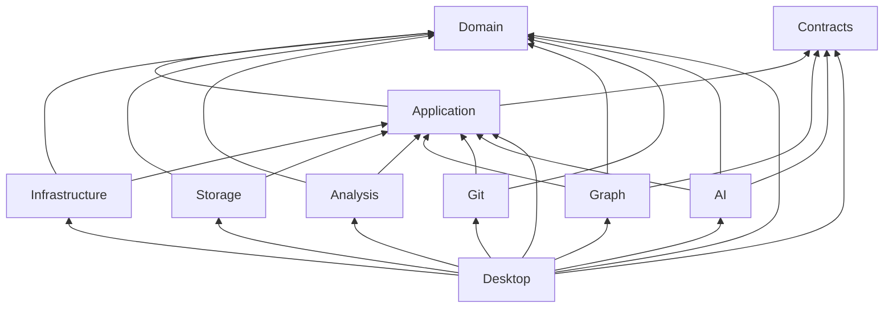

# Solution Structure — Codebase Explorer

> Status: **implemented** (skeleton) · Last reviewed: 2026-11-17

## 1. Repository layout

```text
CodebaseExplorer/
├── CodebaseExplorer.slnx            # Solution (XML solution format, .NET 10 SDK default)
├── global.json                      # SDK 10.0.100+ (latestFeature), Microsoft.Testing.Platform runner
├── Directory.Build.props            # Shared MSBuild settings (net10.0, nullable, warnings as errors …)
├── Directory.Packages.props         # Central Package Management (all versions)
├── .editorconfig                    # Code style
├── README.md · CLAUDE.md · LICENSE
├── docs/                            # Product, architecture, implementation, decisions, development
├── src/
│   ├── CodebaseExplorer.Domain/
│   ├── CodebaseExplorer.Contracts/
│   ├── CodebaseExplorer.Application/
│   ├── CodebaseExplorer.Infrastructure/
│   ├── CodebaseExplorer.Storage/
│   ├── CodebaseExplorer.Analysis/
│   ├── CodebaseExplorer.Graph/
│   ├── CodebaseExplorer.Git/
│   ├── CodebaseExplorer.AI/
│   └── CodebaseExplorer.Desktop/    # Avalonia app + composition root (assembly name: CodebaseExplorer)
├── tests/
│   ├── Directory.Build.props        # Test project defaults (xunit.v3, NSubstitute, MTP)
│   ├── CodebaseExplorer.Domain.Tests/
│   ├── CodebaseExplorer.Analysis.Tests/
│   ├── CodebaseExplorer.Graph.Tests/
│   ├── CodebaseExplorer.Storage.Tests/
│   ├── CodebaseExplorer.IntegrationTests/
│   └── CodebaseExplorer.TestRepositories/   # Fixture repositories + locator (not a test project)
└── tools/
    └── development/                 # Developer scripts (see tools/development/README.md)
```

## 2. Project reference graph (implemented and test-enforced)



Test project references:

| Test project | References | Purpose |
|---|---|---|
| Domain.Tests | Domain | Unit tests of model invariants, IDs, value objects. |
| Analysis.Tests | Analysis, TestRepositories | Analyzer tests against fixture repositories (`InternalsVisibleTo` will be added when internals need testing). |
| Graph.Tests | Graph | Projection/aggregation tests with in-memory model slices. |
| Storage.Tests | Storage | Mapping, migration and query tests against SQLite (temporary files / in-memory connection). |
| IntegrationTests | Desktop (→ all), TestRepositories | Architecture rule tests, composition root tests, end-to-end use-case tests. |

## 3. Internal folder conventions per project

| Project | Folders (planned unless marked) |
|---|---|
| Domain | `Repositories/`, `Projects/`, `Modules/`, `Files/`, `Entities/`, `Relationships/`, `Evidence/`, `Dependencies/`, `Analysis/`, `Common/` (IDs, `SourceLocation`, guards). One aggregate concept per folder. |
| Contracts | `Graph/` (graph DTOs + message envelopes), `Queries/` (read-model DTOs for ViewModels), `Export/`. |
| Application | `Abstractions/` (cross-cutting ports — **exists**: `IApplicationPaths`), `Repositories/`, `Analysis/`, `Graph/`, `Inspector/`, `Git/`, `AI/`, `Export/`, `Common/` (results, errors, progress). Each feature folder contains its use cases and the ports it needs. |
| Analysis | `Pipeline/`, `Scanning/`, `ProjectSystems/DotNet`, `ProjectSystems/Node`, `ProjectSystems/Python`, `Languages/CSharp`, `Languages/TreeSitter`, `Languages/TypeScript`, `Languages/Python`, `Linking/`, `Safety/`. |
| Graph | `Projection/`, `Aggregation/`, `Queries/`, `Budget/`. |
| Git | `LibGit2/` (adapter), `Cloning/`, `History/`. |
| AI | `Providers/`, `Retrieval/`, `Prompting/`, `Citations/`, `Conversations/`. |
| Storage | `Persistence/` (`DbContext`, entities, configurations), `Migrations/`, `Stores/` (port implementations), `Search/` (FTS). |
| Infrastructure | `FileSystem/` (**exists**: `ApplicationPaths`), `Secrets/`, `Logging/`. |
| Desktop | `Composition/` (**exists**), `Services/` (**exists**: theme), `ViewModels/` (**exists**), `Views/` (**exists**), `Controls/` (graph host), `Assets/`, `GraphView/` (built web assets, generated). |

Every module has exactly one public `DependencyInjection` class (**exists** for all modules).

## 4. Planned additional project: graph web view (documented deviation)

The requested structure has no place for the TypeScript/Vite/Cytoscape.js frontend. It will be
added in task **GRAPH-003** as:

```text
src/CodebaseExplorer.GraphView.Web/     # not a .NET project
├── package.json · package-lock.json · tsconfig.json · vite.config.ts
├── src/ (main.ts, bridge.ts, styles.ts, layouts.ts)
└── dist/ (build output, git-ignored)
```

**Reason for the deviation:** the graph renderer is a separate technology stack with its own build
(npm/Vite) and tests (Vitest). Keeping it in its own folder isolates Node tooling from .NET
projects. The Desktop project consumes the built `dist/` output as embedded resources via an
MSBuild target that runs only when the web sources change (exact mechanism decided in GRAPH-003;
the .NET build must keep working without Node installed by using a committed or cached build —
open item for GRAPH-003).

No other deviations from the requested structure exist.

## 5. Build configuration

| Setting | Value | Where |
|---|---|---|
| Target framework | `net10.0` | Directory.Build.props |
| SDK | `10.0.100`, `rollForward: latestFeature` (verified with SDK 10.0.402) | global.json |
| Nullable reference types | enabled | Directory.Build.props |
| Implicit usings | enabled | Directory.Build.props |
| Warnings | treated as errors; `AnalysisLevel=latest`; code style enforced in build | Directory.Build.props |
| XML docs | generated; CS1591 suppressed | Directory.Build.props |
| Package versions | Central Package Management | Directory.Packages.props |
| Test runner | Microsoft.Testing.Platform (required for xunit.v3 with `dotnet test` on .NET 10 SDK) | global.json |
| Test framework | xunit.v3; NSubstitute for test doubles | tests/Directory.Build.props |

Commands:

```bash
dotnet build CodebaseExplorer.slnx
dotnet test --solution CodebaseExplorer.slnx
dotnet run --project src/CodebaseExplorer.Desktop
```

## 6. Dependencies

### 6.1 Referenced packages (verified on nuget.org, 2026-11-17)

| Package | Version | Used by | Notes |
|---|---|---|---|
| Avalonia, Avalonia.Desktop, Avalonia.Themes.Fluent, Avalonia.Fonts.Inter | 12.1.6 | Desktop | MIT; targets net8.0/net10.0. |
| CommunityToolkit.Mvvm | 8.4.2 | Desktop | MIT; source-generated `[ObservableProperty]` on partial properties. |
| Microsoft.Extensions.DependencyInjection | 10.0.15 | Desktop | 10.0.x servicing line to match net10.0. |
| Microsoft.Extensions.DependencyInjection.Abstractions | 10.0.15 | Application and all technical modules | Not referenced by Domain/Contracts. |
| Microsoft.Extensions.Logging, .Abstractions, .Debug | 10.0.15 | Desktop | File sink added in CORE-007. |
| xunit.v3 | 4.0.3 | tests | Runs on Microsoft.Testing.Platform. |
| NSubstitute | 6.2.0 | tests | |

### 6.2 Planned dependencies (exist on nuget.org/npm; **not yet referenced**)

Each entry must be re-verified (version, TFM compatibility, license, maintenance, native assets for
win-x64/osx-arm64/linux-x64) by the task that introduces it.

| Package | Latest stable seen 2026-11-17 | Planned for | Open verification items |
|---|---|---|---|
| Microsoft.EntityFrameworkCore.Sqlite / .Design | 10.0.15 (11.0.0 exists but targets net11.0) | STORE-001 | FTS5 availability in the bundled SQLite build (AI-003). |
| Microsoft.CodeAnalysis.CSharp(.Workspaces) | 5.12.0 | ANALYSIS-005 | Only syntax/semantic APIs are used; `Microsoft.CodeAnalysis.Workspaces.MSBuild` and `Microsoft.Build.Locator` are **deliberately not used** (they evaluate MSBuild = code execution, see ADR-004). |
| TreeSitter.DotNet | 1.3.0 (MIT, netstandard2.0, published 2026-01) | ANALYSIS-008 | Which grammars are bundled (C#, TS, TSX, JS, Python); native binaries for all RIDs; parser timeout/cancellation; maintenance level (single maintainer). Alternatives must be evaluated in the spike. |
| LibGit2Sharp | 0.32.0 (targets net8.0/net472, published 2026-07) | GIT-001 | Native binaries for osx-arm64/linux-x64; SSH not supported (OPD-02); shallow clone support. |
| Avalonia.Controls.WebView | 12.1.2 (MIT, net8.0/net10.0) | GRAPH-001 | Platform backends and runtime requirements on Linux/macOS; JS↔.NET messaging API; local asset loading; navigation restrictions. |
| Microsoft.Extensions.AI / .Abstractions | 10.11.0 (10.x line) | AI-001 | Independently versioned, exempt from the 10.0.x rule (DEVELOPMENT_GUIDE.md §4); check that its dependencies resolve to 10.0.x runtime packages. |
| OllamaSharp | 5.5.2 | AI-002 | `IChatClient` implementation compatibility with the chosen Microsoft.Extensions.AI version. |
| Microsoft.Extensions.AI.OpenAI | to be verified | AI-007 (post-MVP) | Version line compatible with net10.0. |
| npm: cytoscape | 3.35.0 (MIT) | GRAPH-003 | — |
| npm: vite / typescript / vitest | 8.3.8 / 7.0.2 / 5.1.0 | GRAPH-003 | TypeScript 7 (native compiler) compatibility with the Vite toolchain. |
| npm: cytoscape layout extensions | cytoscape-dagre 4.1.0 (MIT), cytoscape-elk 2.4.0 (MIT, depends on elkjs: EPL-2.0 OR GPL-3.0), cytoscape-fcose 2.2.0 (MIT, last release 2023) | GRAPH-005 | **License review for elkjs (EPL-2.0)** before use; maintenance of fcose. |

### 6.3 Deliberately not used

| Package | Reason |
|---|---|
| Avalonia.Diagnostics | Latest stable is 11.3.23; no Avalonia 12 version was found. Dev tooling for Avalonia 12 is evaluated separately (task UI-001). |
| Microsoft.Build.Locator, Microsoft.CodeAnalysis.Workspaces.MSBuild | Load and evaluate project files through MSBuild, which can execute repository-defined logic. Violates the zero-execution rule. |
| xunit.runner.visualstudio, Microsoft.NET.Test.Sdk, coverlet.collector | VSTest-based; the .NET 10 SDK requires Microsoft.Testing.Platform for xunit.v3 with `dotnet test`. Coverage via a Microsoft.Testing.Platform extension will be evaluated in QA-001. |
