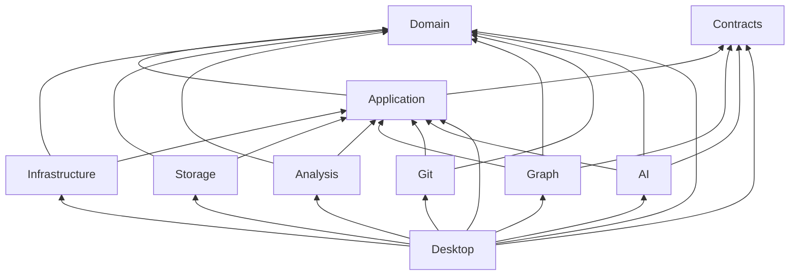

# Solution Structure — Codebase Explorer

> Status: **implemented** (skeleton) · Last reviewed: 2026-11-17

## 1. Repository layout

```text
CodebaseExplorer/
├── CodebaseExplorer.slnx            # Solution (XML solution format, .NET 10 SDK default)
├── global.json                      # SDK 10.0.100+ (latestFeature), Microsoft.Testing.Platform runner
├── Directory.Build.props            # Shared MSBuild settings (net10.0, nullable, warnings as errors …)
├── Directory.Build.targets          # Trims unused native Tree-sitter grammars/RIDs from build output (ANALYSIS-008)
├── Directory.Packages.props         # Central Package Management (all versions)
├── .editorconfig                    # Code style
├── README.md · CLAUDE.md · LICENSE
├── docs/                            # Product, architecture, implementation, decisions, development
├── src/
│   ├── CodebaseExplorer.Domain/
│   ├── CodebaseExplorer.Contracts/
│   ├── CodebaseExplorer.Application/
│   ├── CodebaseExplorer.Infrastructure/
│   ├── CodebaseExplorer.Storage/
│   ├── CodebaseExplorer.Analysis/
│   ├── CodebaseExplorer.Graph/
│   ├── CodebaseExplorer.Git/
│   ├── CodebaseExplorer.AI/
│   └── CodebaseExplorer.Desktop/    # Avalonia app + composition root (assembly name: CodebaseExplorer)
├── tests/
│   ├── Directory.Build.props        # Test project defaults (xunit.v3, NSubstitute, MTP)
│   ├── CodebaseExplorer.Domain.Tests/
│   ├── CodebaseExplorer.Analysis.Tests/
│   ├── CodebaseExplorer.Graph.Tests/
│   ├── CodebaseExplorer.Storage.Tests/
│   ├── CodebaseExplorer.IntegrationTests/
│   └── CodebaseExplorer.TestRepositories/   # Fixture repositories + locator (not a test project)
└── tools/
    ├── development/                 # Developer scripts (see tools/development/README.md)
    └── icon/                        # App icon source (SVG) and generator (New-AppIcon.ps1, Windows PowerShell)
```

## 2. Project reference graph (implemented and test-enforced)



Test project references:

| Test project | References | Purpose |
|---|---|---|
| Domain.Tests | Domain | Unit tests of model invariants, IDs, value objects. |
| Analysis.Tests | Analysis, TestRepositories | Analyzer tests against fixture repositories (`InternalsVisibleTo` will be added when internals need testing). |
| Graph.Tests | Graph | Projection/aggregation tests with in-memory model slices. |
| Storage.Tests | Storage | Mapping, migration and query tests against SQLite (temporary files / in-memory connection). |
| IntegrationTests | Desktop (→ all), TestRepositories | Architecture rule tests, composition root tests, end-to-end use-case tests. |

## 3. Internal folder conventions per project

| Project | Folders (planned unless marked) |
|---|---|
| Domain | **exists:** `Repositories/`, `Projects/`, `Modules/`, `Files/`, `Entities/`, `Relationships/`, `Evidence/`, `Dependencies/`, `Runs/` (analysis runs, diagnostics, statistics), `Model/` (`ArchitectureModel` snapshot and validation), `Common/` (IDs, natural keys, value objects, kind tokens). One aggregate concept per folder. The run folder is named `Runs` rather than `Analysis` so that `CodebaseExplorer.Domain.Analysis` cannot be confused with the `CodebaseExplorer.Analysis` module. |
| Contracts | `Repositories/` (**exists**: `RepositoryImportSummaryDto`, `DiagnosticDto`), `Graph/` (**exists**: graph DTOs, `GraphQuery`, wire tokens, `GraphJsonContext`; `Graph/Messages`: envelope, payloads, serializer), `Queries/` (read-model DTOs for ViewModels), `Export/` (**exists**: `ArchitectureReportRequest`, `ReportSections`, `ArchitectureReportDto`; EXPORT-001), `AI/` (**exists**: conversation, message, citation and context DTOs; AI-006). |
| Application | `Abstractions/` (cross-cutting ports — **exists**: `IApplicationPaths`, `IDatabaseInitializer`, `IStorageMaintenance`), `Repositories/` (**exists**: use cases `ImportLocalRepository`, `ListRecentRepositories`, `OpenRepository`, `RemoveRepository`, `GetRunHistory`, `GetRepositoryOverview`, ports `IRepositoryRootValidator`, `IRepositoryFileReader`, `IArchitectureModelStore`, `StoredRepositoryModel`, `RepositoryListEntry`, `RepositoryRoot`, `RepositoryErrorCodes`), `Settings/` (**exists**: port `IUserSettingsStore`, `UserSettingKeys`), `Common/` (**exists**: `Result`, `Result<T>`, `ApplicationError`, `ErrorKind`), `Analysis/` (**exists**: `IRepositoryAnalyzer`, `AnalysisRequest`, `RepositoryAnalysis`, `AnalysisErrorCodes`, `AnalysisProgress`, `AnalysisStage`, `AnalysisLimits`), `Graph/` (**exists**: use cases `GetGraphView` and `GetGraphEdgeDetails`, port `IGraphProjector`, `GraphErrorCodes`), `Source/` (**exists**: use case `GetSourceSnippet`, `SourceErrorCodes`), `Inspector/` (**exists**: use case `GetElementDetails`, `InspectorErrorCodes`), `Inspector/`, `Git/` (**exists**: port `IGitRepositoryReader`, `GitRepositoryInfo`, `GitSnapshotInfo`, `GitRemoteInfo`, `GitRemoteUrls`, `GitHistoryWindow`, `GitFileActivity`, `GitFileActivityReport`, `GitProgress`, `GitErrorCodes`, port `IGitRemoteCloner`, `GitCloneUrl`, `GitAccessToken`, use case `ImportRemoteRepository`, port `IGitActivityStore`, `GitActivityIndex`), `AI/` (**exists**: port `IAiAssistant`, `AiSettings`, `AiSettingsStore`, `AiErrorCodes`, port `ISearchIndexStore`, use case `EnsureSearchIndex`, `SourceChunker`, `SearchTerms`, `SecretFilePolicy`, `AiContextManifest`, `AiPromptMessage`, `AiCitation`, use cases `AskRepositoryQuestion` and `AiConversations`, port `IAiConversationStore`), `Export/` (**exists**: use case `ExportArchitectureReport`, `MarkdownReportRenderer`, `MermaidDiagram`, `MarkdownText`, `ExportErrorCodes` — pure text generation, no I/O; EXPORT-001). Each feature folder contains its use cases and the ports it needs. |
| Analysis | `FileSystem/` (**exists**: `RepositoryRootValidator`, `RepositoryFileReader`, `PathContainment`, `FileAccessDiagnostics`, `RepositoryPaths`), `Scanning/` (**exists**: `RepositoryScanner`, `GitIgnoreRule`, `GitIgnoreMatcher`, `FileClassifier`, `LanguageDetector`, `ProjectMarkerDetector`), `Pipeline/` (**exists**: `AnalysisPipeline`, `ModelLinker`, analyzer contracts, `AnalyzerFragment`, `FragmentBuilder`), `Parsing/` (**exists**: `SafeXml`, `SafeJson`), `ProjectSystems/DotNet` (**exists**: `DotNetProjectSystemAnalyzer`, `SolutionParser`, `ProjectFileParser`, `MsBuildExpressions`, `RepositoryMsBuildFileSource`, `DotNetCodes`), `Languages/CSharp` (**exists**: `CSharpAnalyzer` (repository-level, `IRepositoryLanguageAnalyzer`), `CompilationSettings`, `DeclarationCollector`, `CSharpCodes`), `Languages/TreeSitter` (**exists**: `TreeSitterParser`, `TreeSitterGrammar`, `SyntaxWalk`), `ProjectSystems/Node` (**exists**: `NodeProjectSystemAnalyzer`, `PackageManifest`, `WorkspacePatterns`, `PnpmWorkspaceFile`, `TsConfigFile`, `NodeCodes`), `ProjectSystems/Python` (**exists**: `PythonProjectSystemAnalyzer`, `PyProjectFile`, `RequirementsFile`, `SetupCfgFile`, `Pep508`, `PythonManifestFacts`, `PythonCodes`), `Languages/TypeScript` (**exists**: `TypeScriptAnalyzer`, `TypeScriptSyntax`, `ModuleFiles`, `TsConfigResolution`, `TypeScriptCodes`), `Languages/Python` (**exists**: `PythonAnalyzer`, `PythonSyntax`, `PythonNames`), `Linking/`, `Safety/`. |
| Graph | `Projection/` (**exists**: `GraphProjector`, project level), `Aggregation/`, `Queries/`, `Budget/`. |
| Git | `LibGit2/` (**exists**: `LibGit2RepositoryReader`), `Cloning/` (**exists**: `LibGit2RemoteCloner`, `DirectoryRemover`), `History/` (**exists**: `FileActivityWalker`). |
| AI | `Providers/` (**exists**: `IAiProvider`, `AiProviderGate`, `AiTransport`, `OllamaProvider`), `AiAssistant` (**exists**), `Retrieval/` (**exists**: `ContextRetriever`, `SnippetSource`, `RetrievedContext`), `Prompting/` (**exists**: `PromptBuilder`, `PromptPackage`, `TokenEstimator`), `Citations/` (**exists**: `CitationValidator`), `Conversations/`. |
| Storage | `Persistence/` (**exists**: `CodebaseExplorerDbContext`, `Entities/` records, `Configurations/`, `RecordMapper`, converters, connection pragmas, design-time factory, `DatabaseInitializer`, `StorageMaintenance`), `Migrations/` (**exists**: `InitialCreate`, `AddUserSettings`, `AddGitActivity`, `AddSearchIndex` (with hand-written FTS5 SQL), `AddAiConversations`, generated by `dotnet ef`), `Stores/` (**exists**: `ArchitectureModelStore`, `UserSettingsStore`, `GitActivityStore`, `SearchIndexStore` (FTS5), `AiConversationStore`). |
| Infrastructure | `FileSystem/` (**exists**: `ApplicationPaths`), `Logging/` (**exists**: `FileLoggerProvider` rolling file log, `LogRedactor`; CORE-007), `Secrets/`. |
| Desktop | `Composition/` (**exists**), `Services/` (**exists**: theme (`IThemeService`, persisted via `IUserSettingsStore`), `GlobalExceptionHandler`, `IClipboardService`, `IFolderLauncher` (opens a folder through Avalonia's launcher), `IGraphViewHost` + `GraphViewBridge`, `IFolderPicker`, `IReportFileWriter` + `ReportFileWriter` (EXPORT-002), `RepositorySession`, `ShellStatus`), `ViewModels/` (**exists**), `Views/` (**exists**), `GraphView/` (**exists**: built web assets, generated and committed, §4), `Controls/` (**exists**: `GraphHostControl`, `GraphViewNavigationPolicy`), `app.manifest` (**exists**: Windows supportedOS, required for native control hosting), `Assets/` (**exists**: `app-icon.ico` — executable icon via `ApplicationIcon` and window/taskbar icon via `avares://`; `app-icon.png` 512 px; both generated by `tools/icon/New-AppIcon.ps1` from the design in `tools/icon/app-icon.svg` and committed). |

Every module has exactly one public `DependencyInjection` class (**exists** for all modules).

## 4. Additional project: graph web view (documented deviation)

The requested structure has no place for the TypeScript/Vite/Cytoscape.js frontend. It exists since
GRAPH-003 as:

```text
src/CodebaseExplorer.GraphView.Web/     # not a .NET project, not in the .slnx
├── package.json · package-lock.json · tsconfig.json · vite.config.ts · buildInfo.ts
├── src/     protocol.ts (wire types + validation), bridge.ts (transport), graphView.ts (message
│            handling), elements.ts (GraphView → Cytoscape elements), styles.ts, main.ts (entry)
├── public/  index.html (strict CSP, loads graph.js)
└── test/    Vitest tests (protocol, controller, elements, static security checks)
```

**Reason for the deviation:** the graph renderer is a separate technology stack with its own build
(npm/Vite) and tests (Vitest). Keeping it in its own folder isolates Node tooling from .NET projects.

**Build integration (decided in GRAPH-003):**

- `npm run build` type-checks and builds **one classic script** `graph.js` (Vite library mode, IIFE,
  Cytoscape bundled) plus `index.html` and `build-info.json` into
  `src/CodebaseExplorer.Desktop/GraphView/`. A classic script is used because the page is loaded from
  `file://` (ADR-006 spike result) and Chromium applies CORS to module scripts from the `null` origin.
- The output is **committed** (marked `linguist-generated` in `.gitattributes`). The Desktop project
  copies `GraphView/**` to its output, so **the .NET build and tests need no Node**.
- `build-info.json` contains a SHA-256 over the web sources (`buildInfo.ts`); the .NET test
  `GraphViewAssetsTests` recomputes it and fails if the committed bundle is stale. Changing anything
  in the web project therefore requires `npm ci && npm run build` and committing `GraphView/`.

No other deviations from the requested structure exist.

## 5. Build configuration

| Setting | Value | Where |
|---|---|---|
| Target framework | `net10.0` | Directory.Build.props |
| SDK | `10.0.100`, `rollForward: latestFeature` (verified with SDK 10.0.402) | global.json |
| Nullable reference types | enabled | Directory.Build.props |
| Implicit usings | enabled | Directory.Build.props |
| Warnings | treated as errors; `AnalysisLevel=latest`; code style enforced in build | Directory.Build.props |
| XML docs | generated; CS1591 suppressed | Directory.Build.props |
| Package versions | Central Package Management | Directory.Packages.props |
| Test runner | Microsoft.Testing.Platform (required for xunit.v3 with `dotnet test` on .NET 10 SDK) | global.json |
| Test framework | xunit.v3; NSubstitute for test doubles | tests/Directory.Build.props |

Commands:

```bash
dotnet build CodebaseExplorer.slnx
dotnet test --solution CodebaseExplorer.slnx
dotnet run --project src/CodebaseExplorer.Desktop
```

## 6. Dependencies

### 6.1 Referenced packages (verified on nuget.org, 2026-11-17)

| Package | Version | Used by | Notes |
|---|---|---|---|
| Avalonia, Avalonia.Desktop, Avalonia.Themes.Fluent, Avalonia.Fonts.Inter | 12.1.6 | Desktop | MIT; targets net8.0/net10.0. |
| Avalonia.Controls.WebView | 12.1.2 | Desktop | MIT; adopted after spike GRAPH-001, used since GRAPH-004. Verified on Windows (WebView2); needs explicit `AdapterPreference`, `UserDataFolder` and an `app.manifest` with supportedOS. **Open:** macOS (WKWebView), Linux (WebKitGTK — embedding possibly unavailable). |
| CommunityToolkit.Mvvm | 8.4.2 | Desktop | MIT; source-generated `[ObservableProperty]` on partial properties. |
| Microsoft.Extensions.DependencyInjection | 10.0.15 | Desktop | 10.0.x servicing line to match net10.0. |
| Microsoft.Extensions.DependencyInjection.Abstractions | 10.0.15 | Application and all technical modules | Not referenced by Domain/Contracts. |
| Microsoft.Extensions.Logging, .Abstractions, .Debug | 10.0.15 | Desktop (all three), Storage and Infrastructure (.Abstractions) | No third-party log sink: the file log is the in-house `FileLoggerProvider` (Infrastructure, CORE-007). |
| xunit.v3 | 4.0.3 | tests | Runs on Microsoft.Testing.Platform. |
| NSubstitute | 6.2.0 | tests | |
| Microsoft.EntityFrameworkCore.Sqlite | 10.0.15 | Storage | MIT; EF Core 10.0.x because EF Core 11 targets net11.0 only (ADR-005); brings SQLitePCLRaw.bundle_e_sqlite3 2.1.13 (native SQLite for all RIDs). |
| Microsoft.EntityFrameworkCore.Design | 10.0.15 | Storage (`PrivateAssets=all`) | MIT; design-time only, for `dotnet ef migrations`. The tool `dotnet-ef` 10.0.15 (MIT) is pinned in `.config/dotnet-tools.json`. FTS5 availability in the bundled SQLite build is verified in AI-003. |
| Microsoft.CodeAnalysis.CSharp | 5.12.0 | Analysis | MIT; re-verified 2026-11-18 (latest stable, published 2026-11-13, net10.0 asset). Compiler APIs only (syntax trees, compilations, semantic model); `Microsoft.CodeAnalysis.Workspaces.MSBuild` and `Microsoft.Build.Locator` are **deliberately not used** (ADR-004). No analyzers or source generators are ever loaded. |
| Basic.Reference.Assemblies.Net100 | 1.8.15 | Analysis | MIT (jaredpar/basic-reference-assemblies), verified 2026-11-18; .NET 10 reference assemblies embedded as resources (~6 MB). Every C# compilation uses them instead of SDK packs so that entity ids are machine-independent (ADR-011). |
| TreeSitter.DotNet | 1.3.0 | Analysis | MIT (mariusgreuel/tree-sitter-dotnet-bindings), verified 2026-11-18 in spike ANALYSIS-008 (ADR-004 "Spike result"): netstandard2.0, no dependencies, native Tree-sitter runtime and grammars for win/osx/linux x64+arm64 (and 32-bit RIDs). Single maintainer. `Directory.Build.targets` keeps only the runtime and the TypeScript, TSX, JavaScript and Python grammars for 64-bit Windows/macOS/Linux (~26 MB instead of ~600 MB). No per-parse timeout API. |
| Tomlyn | 2.11.1 | Analysis | BSD-2-Clause (xoofx/Tomlyn), verified 2026-11-18 in ANALYSIS-011: net10.0 asset, no dependencies, latest stable (published 2026-11-08), ~7.4 M downloads, actively maintained. Only the syntax parser (`SyntaxParser.Parse`) is used: source positions for evidence, `MaxDepth` (32) rejects deep nesting with a catchable `TomlException`. Chosen over Tomlet/Tommy/CsToml (no source positions in their document models) and an in-house parser (TOML 1.0 is too large to re-implement safely). |
| Microsoft.Extensions.AI | 10.11.0 | AI | MIT; re-verified 2026-11-19 in AI-001. Independently versioned, exempt from the 10.0.x rule (DEVELOPMENT_GUIDE.md §4). 11.0.0 exists but depends on the 11.0 runtime packages, so the 10.x line is kept; 10.11.0 depends on Microsoft.Extensions.* 10.0.13 (resolves within 10.0.x) and brings `Microsoft.Extensions.AI.Abstractions` (`IChatClient`). |
| OllamaSharp | 5.5.2 | AI | MIT (awaescher/OllamaSharp), re-verified 2026-11-19 in AI-002: latest stable, net10.0 asset, depends only on Microsoft.Extensions.AI(.Abstractions) 10.8.0 (resolved to 10.11.0). `OllamaApiClient` implements `IChatClient`; it is created over an HTTP client from `AiTransport` and does not dispose external HTTP clients (the provider does). Ends streaming quietly on cancellation. |
| coverlet.MTP | 10.1.1 | tests | MIT; code coverage as Microsoft.Testing.Platform extension (QA-001, TEST_STRATEGY.md §7.1). |
| LibGit2Sharp | 0.32.0 | Git; test helper `GitRepositoryBuilder` in TestRepositories (GIT-002) | MIT; verified 2026-11-18 in spike GIT-006 (GIT_INTEGRATION.md §3.1): targets net8.0 and net472, depends on LibGit2Sharp.NativeBinaries 2.0.324 (libgit2, GPL-2.0 with linking exception) with native binaries for all target RIDs incl. musl. Runs no hooks, fsmonitor, filter drivers or credential helpers. SSH URLs would start the system `ssh` executable, so the app rejects them (OPD-02). |

**Developer tooling for Avalonia 12 (evaluated in UI-001, 2026-11-18): not adopted.** `Avalonia.Diagnostics`
(the in-app DevTools with `AttachDevTools()`) ends at 11.3.23 and depends on Avalonia 11, so it cannot be used
with Avalonia 12. Its successor `AvaloniaUI.DiagnosticsSupport` (2.2.3) only bridges to the separate
"AvaloniaUI Developer Tools" application and declares no license in its package. No diagnostics package is
referenced; developers who use the external tool add it locally without committing it. Revisit if an
OSI-licensed option for Avalonia 12 appears.

### 6.2 Planned dependencies (exist on nuget.org/npm; **not yet referenced**)

Each entry must be re-verified (version, TFM compatibility, license, maintenance, native assets for
win-x64/osx-arm64/linux-x64) by the task that introduces it.

| Package | Latest stable seen 2026-11-17 | Planned for | Open verification items |
|---|---|---|---|
| Microsoft.Extensions.AI.OpenAI | to be verified | AI-007 (post-MVP) | Version line compatible with net10.0. |
| npm: cytoscape | 3.35.0 (MIT) | **adopted** (GRAPH-003) | Bundled into `graph.js`. |
| npm: vite / typescript / vitest / @types/node | 8.3.8 / 7.0.2 / 5.1.0 / 26.6.6 | **adopted** (GRAPH-003, dev only, exact versions) | Verified: TypeScript 7.0.2 provides `tsc` and type-checks the project; Vite 8 builds; Vitest 5 runs. `npm audit` (2026-11-17) reports a high-severity ReDoS in `picomatch` (GHSA-fc5q-39xc-vjpf, all versions, no fix released) reached through Vite/Vitest. **Accepted:** build-time only, applied to our own glob patterns, not shipped; the offered `--force` fix would downgrade Vite to 6.x. Re-check when a fixed `picomatch` is released. |
| npm: cytoscape-dagre | 4.1.0 (MIT, published 2026-11-10) | **adopted** (GRAPH-005, hierarchical layout, exact version) | Verified on npmjs.com 2026-11-18. No runtime dependencies: the dist file bundles @dagrejs/dagre 3.x and @dagrejs/graphlib (both MIT), so all bundled code is MIT; ships its own type declarations. Actively maintained (3.0.0–4.1.0 released in 2026). |
| npm: cytoscape-fcose | 2.2.0 (MIT, published 2023-01-17) | **adopted** (GRAPH-005, default force layout, exact version) | Verified on npmjs.com 2026-11-18. Dependencies cose-base 2.2.0 and layout-base 2.0.1 (both MIT, from the same i-Vis group of Bilkent University). No release since 2023: accepted because it is pure computation without I/O or network, small and widely used with Cytoscape; if it breaks with a future Cytoscape version, the fallback is euler or dagre (§8 of GRAPH_ENGINE.md). No type declarations (`src/vendor.d.ts`). `cytoscape-layout-utilities` (needed for fcose's `packComponents`) is deliberately not added. |
| npm: cytoscape-elk / elkjs | cytoscape-elk 2.4.0 (MIT) → elkjs 0.12.1 (**EPL-2.0 OR GPL-3.0-or-later**; cytoscape-elk itself still requests `^0.9.3`) | **not adopted** (GRAPH-005) | License review: bundling elkjs into `graph.js` would make the shipped bundle contain EPL-2.0 code (weak copyleft: the elkjs part must be offered in source form under EPL-2.0 with its notices, and its secondary-license/GPL option adds complexity), or GPL-3.0 code, which would affect the whole distributed application. The benefit does not justify it: ELK layered was not faster than dagre in the GRAPH-005 measurements (2.5–3.2 s vs 2.2–2.8 s at 500 / 2,000) and adds a large GWT-transpiled bundle. Re-evaluate only with a legal review if a layout feature only ELK has (e.g. port constraints) becomes necessary. |
| npm: cytoscape-euler, cytoscape-cola | 1.2.4 (MIT) / 2.5.1 (MIT, depends on webcola 3.4.0 and d3 v1 modules) | **not adopted** (GRAPH-005) | euler measured (1.5 s at 500 / 2,000) but spreads disconnected components apart; cola not needed. |

### 6.3 Deliberately not used

| Package | Reason |
|---|---|
| Avalonia.Diagnostics | Latest stable is 11.3.23; no Avalonia 12 version was found. Dev tooling for Avalonia 12 is evaluated separately (task UI-001). |
| Microsoft.Build.Locator, Microsoft.CodeAnalysis.Workspaces.MSBuild | Load and evaluate project files through MSBuild, which can execute repository-defined logic. Violates the zero-execution rule. |
| xunit.runner.visualstudio, Microsoft.NET.Test.Sdk, coverlet.collector | VSTest-based; the .NET 10 SDK requires Microsoft.Testing.Platform for xunit.v3 with `dotnet test`. Coverage uses coverlet.MTP instead (QA-001). |
