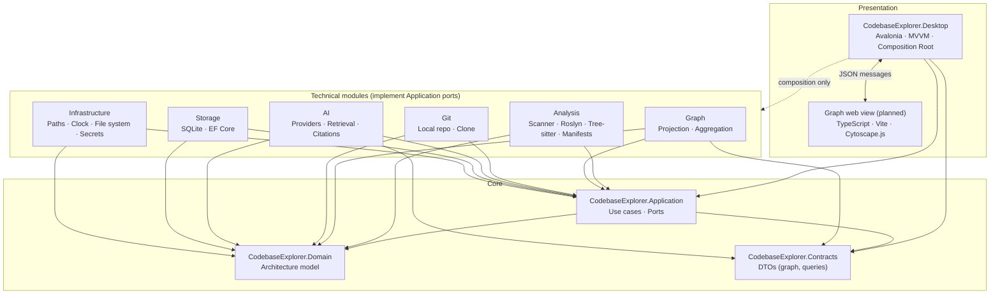
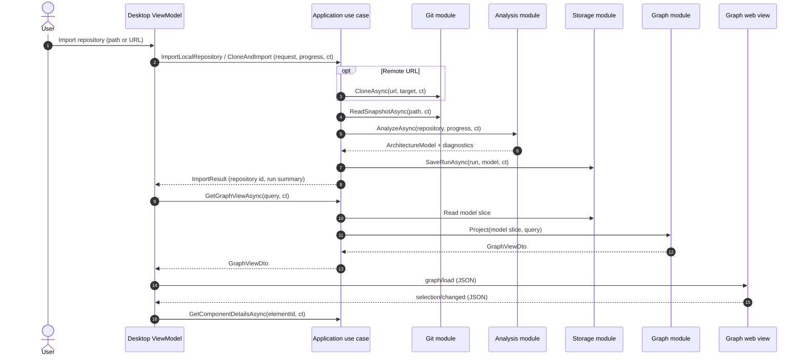
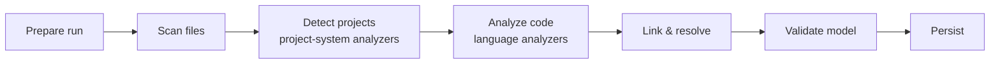
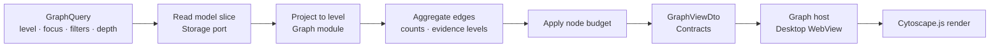

# System Architecture — Codebase Explorer

> Status: **accepted** · Last reviewed: 2026-11-17
> Implementation status: solution skeleton, dependency rules (enforced by tests), composition root and
> app shell exist. All module internals described here are **planned**.

## 1. Architectural drivers

| Driver | Consequence for the architecture |
|---|---|
| Visual-first desktop product | Rich client (Avalonia) with an embedded graph renderer (Cytoscape.js in a WebView). |
| Cross-platform (Windows, macOS, Linux) | .NET 10 + Avalonia; no Windows-only APIs; native dependencies (WebView, Tree-sitter, libgit2) must ship for all three OSes. |
| Polyglot analysis | Language-independent domain model; independent analyzers behind one contract. |
| Very large repositories | Hierarchical model and graph aggregation; streaming/batched persistence; bounded parallelism; incremental analysis as long-term goal. |
| Trustworthiness | Evidence for every relationship; deterministic analysis; AI is optional and grounded. |
| Security & privacy | Zero execution of repository code; local-first storage; explicit opt-in for cloud AI. |
| Long-lived codebase developed with AI agents | Strict, test-enforced module boundaries; small modules with clear ownership; ADRs. |

## 2. Architectural style

Codebase Explorer is a **modular monolith** ([ADR-001](../decisions/ADR-001-modular-monolith.md))
structured by **Clean Architecture** dependency rules:

- One process, one deployable desktop application.
- Modules are separate assemblies with explicit, test-enforced references.
- The **Domain** is the innermost layer; it depends on nothing.
- The **Application** layer contains use cases and the *ports* (interfaces) that modules implement.
- Technical modules (**Analysis, Graph, Git, AI, Storage, Infrastructure**) implement ports and do
  not reference each other.
- **Desktop** is the presentation layer *and* the composition root.



## 3. Dependency rules

These rules are binding. The **project-reference** parts of rules 1–3 (and the absence of package
references in Domain/Contracts) are enforced by
`tests/CodebaseExplorer.IntegrationTests/Architecture/ProjectReferenceRulesTests.cs`. All other
rules, including Application's package restriction and rule 4, are enforced by review
(Definition of Done).

| # | Rule |
|---|---|
| 1 | `Domain` and `Contracts` reference no other project and no NuGet package. |
| 2 | `Application` references only `Domain` and `Contracts` (plus `Microsoft.Extensions.*.Abstractions`). |
| 3 | Technical modules reference only `Application` and `Domain`; `Graph` and `AI` additionally reference `Contracts`. **Modules never reference each other.** Any other module needing `Contracts` requires an ADR and a test update. |
| 4 | `Desktop` references all projects, but only the composition root (`Composition/`) may use module types. ViewModels use Application use cases/ports and Contracts DTOs. |
| 5 | EF Core entities never leave `Storage`. Storage maps between persistence entities and Domain objects. |
| 6 | Graph visualization uses its own DTOs (`Contracts`), never Domain objects or EF entities. |
| 7 | Analyzer implementations are internal to `Analysis` and independent of each other. |
| 8 | Infrastructure packages (Roslyn, Tree-sitter, LibGit2Sharp, EF Core, Microsoft.Extensions.AI, Avalonia) are referenced only by the module that owns them. |
| 9 | No module starts processes that execute repository content. See SECURITY.md. |

Any change to these rules requires a new or superseding ADR **and** an update of the architecture tests.

## 4. Module responsibilities

| Project | Responsibility | Owns (packages) | Must not |
|---|---|---|---|
| **Domain** | Architecture model: `Repository`, `CodeProject`, `CodeModule`, `RepositoryFile`, `CodeEntity`, `CodeRelationship`, `AnalysisEvidence`, `ExternalDependency`, `AnalysisRun`; value objects (stable IDs, locations); invariants. | — | Know about UI, persistence, analyzers, Git, AI. |
| **Contracts** | Serializable DTOs crossing process/technology boundaries: graph view DTOs (to the web view), query result DTOs for ViewModels, export DTOs. | — | Contain behavior beyond trivial validation. |
| **Application** | Use cases (`ImportRepository`, `RunAnalysis`, `GetGraphView`, `GetComponentDetails`, `AskRepositoryQuestion` …), ports (`IRepositoryAnalyzer`, `IArchitectureModelStore`, `IGraphProjector`, `IGitRepositoryReader`, `IAiAssistant` …), progress/cancellation models, application errors. | `Microsoft.Extensions.DependencyInjection.Abstractions` | Reference technical modules; contain parsing, SQL, UI. |
| **Analysis** | Repository scanner, project-system analyzers (.NET, Node, Python), language analyzers (Roslyn C#, Tree-sitter TS/JS/Python), linking/resolution, pipeline orchestration, analysis limits. | Roslyn, Tree-sitter bindings | Execute repository code; access the database directly; reference other modules. |
| **Graph** | Projection of the architecture model into graph DTOs: levels, aggregation, filters, neighborhood queries, node budget, layout hints. | — | Render anything; depend on Cytoscape specifics beyond DTO shape. |
| **Git** | Git repository detection, metadata (branch, HEAD, remotes), history statistics, remote cloning over HTTPS. | LibGit2Sharp (planned adapter) | Run Git hooks or repository-configured commands. |
| **AI** | Provider abstraction over `Microsoft.Extensions.AI`, Ollama provider, optional cloud providers, retrieval of context, prompt construction, citation validation, conversation handling. | Microsoft.Extensions.AI, OllamaSharp (planned) | Be required for any other feature; send data to cloud providers without explicit configuration. |
| **Storage** | `DbContext`, persistence entities, mappings, migrations, repositories implementing storage ports, full-text index for retrieval. | EF Core (SQLite provider) | Leak EF entities or `IQueryable` outside the module. |
| **Infrastructure** | Cross-cutting technical services: application paths, `TimeProvider`, file-system access helpers, secret storage (OPD-03), logging sinks. | — (grows as needed) | Host business logic. |
| **Desktop** | Avalonia shell, Views, ViewModels, navigation, theming, graph host control (WebView), dialogs, composition root. | Avalonia, CommunityToolkit.Mvvm, Microsoft.Extensions.DependencyInjection/Logging | Put business logic in Views or code-behind; talk to EF Core/Roslyn directly. |

## 5. Application composition root

`src/CodebaseExplorer.Desktop/Composition/CompositionRoot.cs` is the single place where the
service provider is built (**implemented**):

```csharp
services
    .AddApplication()
    .AddInfrastructure()
    .AddStorageModule()
    .AddAnalysisModule()
    .AddGraphModule()
    .AddGitModule()
    .AddAiModule()
    .AddDesktop();
```

- Each module exposes exactly one public registration method in its `DependencyInjection` class.
  Implementations stay `internal`; only ports (Application) and DTOs (Contracts) are public API.
- `ValidateOnBuild` and `ValidateScopes` are enabled; `CompositionRootTests` verify that the
  container builds and the shell resolves.
- Lifetimes: stateless services and ports → singleton; `DbContext` → created per unit of work via
  `IDbContextFactory` (no scoped DbContext in a desktop app); ViewModels → singleton for top-level
  pages, transient for dialogs/documents.
- Configuration (user settings) is loaded through an Application port, not `IConfiguration` files
  inside the repository being analyzed.

## 6. Runtime data flow



**Implemented (CORE-006, STORE-004):** `ImportLocalRepository` (validate → `AnalysisRun` Pending →
Running → analyze → complete or fail/cancel → `IArchitectureModelStore.SaveRunAsync`) and
`GetGraphView` / `GetGraphEdgeDetails` (`IArchitectureModelStore.LoadCurrentModelAsync` →
`IGraphProjector`). The store is SQLite (Storage); models survive restarts. Every finished run is
recorded; only a run that produced a model replaces the stored model, in one transaction, so failed and
cancelled runs leave the previous model intact. One import per folder at a time
(`repository.import-in-progress`); cancellation propagates `OperationCanceledException`; re-importing a
folder keeps its `RepositoryId`. The use cases return Contracts DTOs (`RepositoryImportSummaryDto`,
`GraphViewDto`), so ViewModels never see Domain types.

**Implemented (REPO-005):** `ListRecentRepositories` (`IArchitectureModelStore.ListRepositoriesAsync`, ordered
by last use), `OpenRepository` (stored model, no analysis; sets `LastOpenedAt` via `MarkOpenedAsync`, as does a
successful import) and `RemoveRepository` (`DeleteRepositoryAsync`: one `DELETE` on `Repositories`, the
foreign keys cascade to runs, diagnostics and all model tables; the analyzed folder is never touched).
The Desktop `RepositorySession` holds an `OpenRepositoryDto`; pages refresh via `PageViewModel.ActivateAsync`
when the shell shows them.

**Implemented (UI-005):** `GetRunHistory` (`IArchitectureModelStore.ListRunsAsync`, newest first with
diagnostics) returns `AnalysisRunDto`s; diagnostic file paths are resolved against the current model, so a
file that only existed in an older (replaced) model keeps its line but loses its path.

**Implemented (UI-004):** `GetRepositoryOverview` computes `RepositoryOverviewDto` from the stored model
(languages, projects per ecosystem without placeholders, external dependencies, run of the model, newer
unsuccessful run). The shell shows the overview after an import or opening (WF-01 step 5).

Principles:

- **Async all the way** for I/O; every long-running call accepts a `CancellationToken` and an
  `IProgress<T>` where progress is meaningful.
- The UI thread only dispatches commands and applies results; analysis runs on background tasks.
- The model is written once per run (batched, transactional) and read in **slices** (by level,
  focus element, filters) — the full model of a monorepo is never loaded into the UI. *Current state
  (STORE-004, decided 2026-11-18):* the Application layer reads the whole current model (cached per run)
  and the UI only receives projected DTOs; SQL slice queries follow with the node budget and benchmarks in
  M4 (GRAPH-008, QA-002); see ADR-010.

## 7. Analyzer pipeline (overview)

Details: [ANALYSIS_ENGINE.md](ANALYSIS_ENGINE.md).



Analyzers are independent plug-ins with one contract; they produce **fragments** keyed by natural
keys; the linker merges fragments, resolves cross-references and assigns stable IDs and evidence
levels.

## 8. Graph pipeline (overview)

Details: [GRAPH_ENGINE.md](GRAPH_ENGINE.md).



## 9. Git integration (overview)

Details: [GIT_INTEGRATION.md](GIT_INTEGRATION.md). The Git module is behind Application ports
(`IGitRepositoryReader`, `IGitRemoteCloner`) so that the initial LibGit2Sharp adapter can be
replaced or complemented (e.g. a Git CLI adapter for SSH) without affecting other modules.

## 10. AI integration (overview)

Details: [AI_ARCHITECTURE.md](AI_ARCHITECTURE.md). The AI module is optional and disabled by
default. It consumes analysis results through Application ports (never the database directly),
uses `Microsoft.Extensions.AI` abstractions for providers, and returns answers with citations that
are validated against the stored model before display.

## 11. Cross-cutting concerns

| Concern | Approach |
|---|---|
| **Errors** | Expected failures (invalid path, parse error, auth failure) are returned as typed results/diagnostics; exceptions are for programming errors and infrastructure faults. Analyzer failures are isolated per analyzer and per project. |
| **Logging** | `Microsoft.Extensions.Logging` (minimum level Information; EF Core only from Warning) with the debug provider and an in-house rolling file log (`FileLoggerProvider`, Infrastructure; CORE-007 — no third-party sink): `<data>/logs/codebase-explorer-yyyyMMdd[-n].log`, a new file per UTC day and at 10 MB, the newest 10 files are kept, written and flushed per entry; write errors disable the file log instead of failing the app. Every entry passes `LogRedactor` (credentials in URLs, authorization headers, secret parameters, known token formats → `***`; entries cut at 8,000 characters). Logs never contain source code content or secrets; file paths are allowed. |
| **Unhandled exceptions** | `GlobalExceptionHandler` (Desktop, CORE-007), installed by `App` on the Avalonia dispatcher, `AppDomain.UnhandledException` and `TaskScheduler.UnobservedTaskException`. UI-thread exceptions are logged, marked handled and shown as a notification (the app keeps running); fatal exceptions are logged and leave a marker file in the logs directory, so the next start shows that the app closed unexpectedly; unobserved task exceptions are logged and observed. A failure during startup shows `StartupErrorWindow` with the log directory. |
| **Cancellation** | Mandatory `CancellationToken` on every async public method that performs I/O or CPU-heavy work. |
| **Progress** | `IProgress<AnalysisProgress>` with stage, processed/total counts and current item. |
| **Concurrency** | Bounded parallelism (`Parallel.ForEachAsync` / channels) with a configurable degree; one analysis run per repository at a time. |
| **Time** | `TimeProvider` injected (registered in Infrastructure) for testability. |
| **Serialization** | `System.Text.Json` with source generation for Contracts DTOs (graph messages). |
| **Configuration** | User settings persisted in the `UserSettings` table; no configuration is read from analyzed repositories except as analysis input. |
| **Theming** | Fluent theme, light/dark/system; the graph web view receives theme changes via message. |

## 12. Deployment view

Single desktop application per OS, published self-contained per runtime identifier
(`win-x64`, `osx-arm64`, `linux-x64`; others optional). Native components that must be present per
RID: Avalonia native backends, WebView backend (WebView2 on Windows, system WebKit on macOS/Linux —
to be verified in GRAPH-001), SQLite (via the EF Core SQLite provider's native bundle), Tree-sitter
native libraries (to be verified in ANALYSIS-008), libgit2 (LibGit2Sharp native binaries for all target
RIDs incl. musl, verified in GIT-006). Packaging is defined in task QA-004.

## 13. Quality attribute scenarios

| Attribute | Scenario | Response measure |
|---|---|---|
| Performance | Import of a 2,000-project repository on a developer laptop | Project graph visible < 3 min; UI responsive throughout. |
| Scalability | Repository with 100k source files | Analysis completes within memory budget (4 GB); graph starts at aggregated level. |
| Security | Repository contains MSBuild targets with `Exec`, npm `postinstall`, malicious `setup.py` | Nothing executed (verified by hostile fixtures). |
| Privacy | AI disabled (default) | No outbound network traffic except explicit clones. |
| Modifiability | Add Go support | New analyzer in `Analysis` only; no Domain/Storage/Graph changes required. |
| Testability | Analyzer change | Verified by fixture repositories with documented expectations. |
