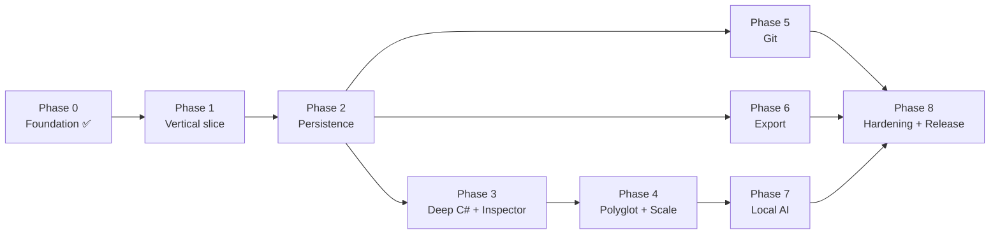

# Implementation Plan — Codebase Explorer

> Status: **accepted** · Last reviewed: 2026-11-17

The plan is organized in phases that build on each other. Each phase corresponds to a milestone
([MILESTONES.md](MILESTONES.md)) and lists its tasks from [TASK_BREAKDOWN.md](TASK_BREAKDOWN.md).
The guiding priority is a **working vertical slice first**:

> **Import repository → detect .NET projects → extract project dependencies → generate graph →
> visualize interactively.**

Later phases deepen (C# semantics), broaden (more languages, scale) and enrich (Git, export, AI).

Phases 5 and 6 depend only on Phase 2 and may run in parallel with Phases 3/4 if capacity allows.

---

## Phase 0 — Foundation (M0) ✅

**Goal:** A documented, buildable foundation that future sessions can build on safely.

**Delivered:** documentation set (product, architecture, ADRs, implementation, development),
`CLAUDE.md`, .NET 10 solution with 10 source and 6 test projects, Central Package Management,
dependency rules enforced by tests, composition root with module registration seams, startable
Avalonia shell (Start, Architecture Explorer placeholder, Settings with theme switch and data
directory).

**Acceptance (met):** `dotnet build` with 0 warnings/0 errors; `dotnet test` green (21 tests);
the app starts and shows the shell.

---

## Phase 1 — Vertical slice: .NET project graph (M1)

**Goal:** A user selects a local folder and sees an interactive graph of its .NET projects and
their project references — end to end, in memory, on all three OSes.

**Tasks:** CORE-001…006, REPO-001…004, ANALYSIS-001…004, GRAPH-001…004, GRAPH-010 (added for the evidence criterion), UI-001…003, QA-001.

**Suggested order:**

1. GRAPH-001 (spike; de-risks the biggest technical unknown early, can run in parallel with 2–4)
2. CORE-001 → CORE-002 → CORE-003 → CORE-004, CORE-005
3. REPO-004 (fixture) · REPO-001 → REPO-002 → REPO-003
4. ANALYSIS-001 → ANALYSIS-002 / ANALYSIS-003 → ANALYSIS-004
5. GRAPH-002 → GRAPH-003 → GRAPH-004
6. CORE-006 → UI-002 → UI-003; UI-001 and QA-001 alongside

**Affected projects:** Domain, Application, Contracts, Analysis, Graph, Desktop, new
`GraphView.Web`, TestRepositories, Domain/Analysis/Graph/Integration tests.

**Dependencies:** none outside the phase. External: WebView viability (GRAPH-001).

**Acceptance criteria:**
- Importing `dotnet-layered` shows 5 project nodes with the correct `ProjectReference` edges.
- Edges carry evidence (file + line) visible at least in a basic side panel.
- Import can be cancelled; failures are shown without crashing.
- Works on Windows, macOS and Linux (manual check documented in the PR).

**Test requirements:** unit tests for domain invariants and IDs; analyzer tests against the
fixture's `EXPECTED.md`; projection tests; end-to-end use-case test (fixture → `GraphViewDto`);
ViewModel tests with substituted use cases; architecture rule tests stay green.

**Definition of Done:** [DEFINITION_OF_DONE.md](DEFINITION_OF_DONE.md) for every task, plus:
README "Project status" updated; MILESTONES.md M1 marked done; ADR-006 status updated by GRAPH-001.

---

## Phase 2 — Persistence and analysis runs (M2)

**Goal:** Analysis results survive restarts; users reopen repositories without re-analysis and see
run history and diagnostics.

**Tasks:** STORE-001…005, REPO-005, UI-004, UI-005, CORE-007, CORE-010.

**Affected projects:** Storage, Application, Desktop, Infrastructure, Storage.Tests, IntegrationTests.

**Dependencies:** Phase 1 (domain model, use cases).

**Acceptance criteria:**
- Reopening a repository shows the stored graph without running analysis.
- Failed/cancelled runs never alter the stored model.
- Database migrations apply automatically with backup; startup with an existing DB works.
- Theme choice persists.

**Test requirements:** mapping round-trip tests per table; migration test (empty → latest);
transactional replace tests; model-store integration test using the fixture; memory benchmark for
1M relationships documented.

**Definition of Done:** DoD + DATABASE_SCHEMA.md matches the implemented schema exactly;
`--ignore-exit-code 8` removed (CORE-010).

---

## Phase 3 — Deep C# analysis and Component Inspector (M3)

**Goal:** C# repositories can be explored down to namespaces and types with confirmed relationships;
the inspector explains every edge with evidence and source snippets; zero execution is proven.

**Tasks:** ANALYSIS-005…007, REPO-006, QA-003, GRAPH-005, GRAPH-006, UI-006, UI-007.

**Affected projects:** Analysis (Roslyn), Graph, Storage (slice queries), Application, Contracts,
Desktop, GraphView.Web, TestRepositories, tests.

**Dependencies:** Phase 2 (slices are read from storage).

**Acceptance criteria:**
- Expand project → namespaces → types works and is reversible.
- Relationships show correct evidence levels; analysis works without SDK reference packs
  (degraded to `Syntactic`).
- Hostile fixtures pass on all OSes.

**Test requirements:** fixture-based analyzer tests (`dotnet-layered`, `dotnet-advanced`);
determinism tests; hostile-fixture integration tests; projection tests for mixed levels.

**Definition of Done:** DoD + ANALYSIS_ENGINE.md "Known limitations" updated with observed facts.

---

## Phase 4 — Polyglot analysis and large repositories (M4)

**Goal:** TypeScript, JavaScript and Python repositories (and polyglot mixes) are analyzed at
package/module level; large repositories stay explorable via aggregation, filters, search and
node budget.

**Tasks:** ANALYSIS-008…013, REPO-007, GRAPH-007, GRAPH-008, GRAPH-009, QA-002.

**Affected projects:** Analysis (Tree-sitter, manifests), Graph, Storage, Desktop, GraphView.Web,
TestRepositories, tools/development.

**Dependencies:** Phase 3 (graph levels); ANALYSIS-008 spike before ANALYSIS-010/012.

**Acceptance criteria:**
- Polyglot fixture shows .NET, Node and Python projects in one graph with correct dependencies.
- Performance fixture: project graph for ≥ 2,000 projects within targets; no view exceeds the node budget.

**Test requirements:** fixture tests per ecosystem; budget tests; benchmark results recorded.

**Definition of Done:** DoD + performance results documented in TEST_STRATEGY.md.

---

## Phase 5 — Git integration (M5)

**Goal:** Git metadata and change activity enrich the model; remote GitHub/GitLab repositories can
be cloned over HTTPS.

**Tasks:** GIT-006 (first), GIT-001…005, UI-008.

**Affected projects:** Git, Application, Storage, Graph, Desktop, TestRepositories.

**Dependencies:** Phase 2. Open decisions OPD-02 (SSH) and OPD-03 (secret storage) are **not**
blockers: HTTPS with in-memory tokens is the MVP baseline.

**Acceptance criteria:** clone → analyze works for public GitHub and GitLab repositories; activity
overlay correct on builder-created histories; hostile Git config executes nothing.

**Test requirements:** builder-based Git tests; URL validation tests; network tests opt-in only.

**Definition of Done:** DoD + GIT_INTEGRATION.md verification table filled with facts.

---

## Phase 6 — Documentation export (M6)

**Goal:** Users export a Markdown architecture report with Mermaid diagrams.

**Tasks:** EXPORT-001, EXPORT-002.

**Affected projects:** Application, Contracts, Desktop.

**Dependencies:** Phase 2.

**Acceptance criteria:** report for `dotnet-layered` matches the snapshot; Mermaid renders in common viewers.

**Test requirements:** snapshot tests; escaping tests for hostile names.

**Definition of Done:** DoD.

---

## Phase 7 — Optional local AI (M7)

**Goal:** With Ollama available, users ask grounded questions and get validated citations; with AI
disabled, nothing changes and no network traffic occurs.

**Tasks:** AI-001…006, AI-008.

**Affected projects:** AI, Application, Storage, Analysis (chunking), Desktop.

**Dependencies:** Phase 4 (multi-language content for retrieval); STORE-005 (settings).

**Acceptance criteria:** network-guard test passes; citations validated; prompt-injection fixture
does not trigger any action (there are no tools) and is rendered as text.

**Test requirements:** stub-server provider tests; retrieval snapshot tests; citation validator tests.

**Definition of Done:** DoD + AI_ARCHITECTURE.md updated with actual package versions.

---

## Phase 8 — Hardening and release (M8)

**Goal:** A releasable MVP on Windows, macOS and Linux.

**Tasks:** QA-004, QA-005, QA-006, UI-009.

**Dependencies:** all previous phases.

**Acceptance criteria:** MVP release gate (MVP_SCOPE.md §5) satisfied.

**Definition of Done:** DoD + release notes, README status, resolved/deferred open decisions.

---

## Planning rules

1. A phase starts only when the previous phase's P0 tasks are done (exceptions: spikes may be
   pulled forward; Phases 5/6 may start after Phase 2).
2. Spikes that invalidate an assumption trigger an ADR update **before** dependent tasks start.
3. Scope changes are recorded in MVP_SCOPE.md §6.
4. Each task is implemented in its own branch/PR (GIT_WORKFLOW.md).
