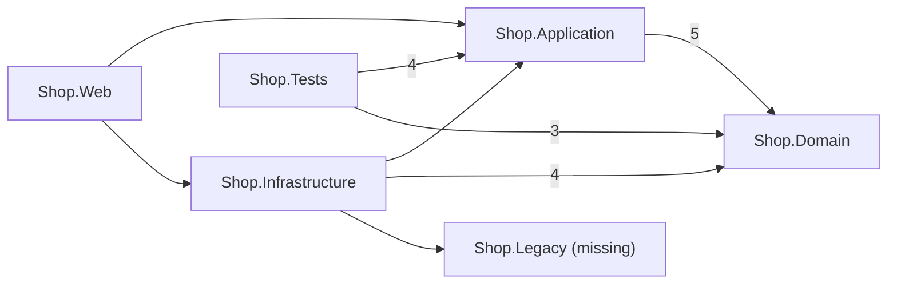

# Architecture report: dotnet-layered

Generated by Codebase Explorer on 2026-11-18 12:00 UTC from the analysis run of 2026-11-18 12:00 UTC. Scope: whole repository.
Every relationship is backed by evidence from static analysis; repository code was not executed.

## Overview

| Item | Value |
|---|---|
| Repository | dotnet-layered |
| Source | Local folder |
| Files | 19 |
| Lines | 375 |
| Projects | 5 |
| Referenced but missing projects | 1 |
| Modules | 11 |
| Code entities | 24 |
| Relationships | 30 |
| External dependencies | 5 |

## Languages

| Language | Files | Lines |
|---|---|---|
| csharp | 9 | 100 |
| xml | 8 | 101 |
| markdown | 1 | 139 |
| sln | 1 | 35 |

## Projects

| Project | Kind | Language | Folder | Files | References | Referenced by | Packages |
|---|---|---|---|---|---|---|---|
| Shop.Application | .NET project | csharp | src/Shop.Application | 3 | 1 | 3 | 1 |
| Shop.Domain | .NET project | csharp | src/Shop.Domain | 4 | 0 | 3 | 0 |
| Shop.Infrastructure | .NET project | csharp | src/Shop.Infrastructure | 3 | 3 | 1 | 1 |
| Shop.Legacy (missing) | Unknown | csharp | src/Shop.Legacy | 0 | 0 | 1 | 0 |
| Shop.Tests | .NET project | csharp | tests/Shop.Tests | 2 | 2 | 0 | 2 |
| Shop.Web | .NET project | csharp | src/Shop.Web | 2 | 2 | 0 | 1 |

## Dependency graph

Projects and their dependencies (project level, including test projects). Edge labels count the relationships; dotted edges rest on heuristic evidence only.

## External dependencies

| Package | Ecosystem | Used by projects |
|---|---|---|
| Microsoft.AspNetCore.App | dotnet-framework | 1 |
| Microsoft.EntityFrameworkCore.Sqlite | nuget | 1 |
| Microsoft.Extensions.DependencyInjection.Abstractions | nuget | 1 |
| NSubstitute | nuget | 1 |
| xunit.v3 | nuget | 1 |

## Analysis metadata

| Item | Value |
|---|---|
| Status | Succeeded |
| Started | 2026-11-18 12:00 UTC |
| Completed | 2026-11-18 12:00 UTC |
| Commit | — (not a Git repository) |
| Branch | — |
| Files scanned / skipped | 19 / 0 |
| Warnings | 1 |
| Errors | 0 |

| Analyzer | Version |
|---|---|
| csharp.roslyn | 1.0.0 |
| dotnet.msbuild-static | 1.0.0 |
| scanner | 1.0.0 |

## Evidence statistics

Evidence levels: *confirmed* (semantic model or authoritative declaration), *syntactic* (syntax or manifest, resolved by name or path), *heuristic* (pattern or convention).

| Relationship kind | Confirmed | Syntactic | Heuristic | Total |
|---|---|---|---|---|
| calls | 2 | 0 | 0 | 2 |
| framework-reference | 1 | 0 | 0 | 1 |
| implements | 1 | 0 | 0 | 1 |
| instantiates | 2 | 0 | 0 | 2 |
| package-reference | 4 | 0 | 0 | 4 |
| project-reference | 7 | 1 | 0 | 8 |
| registers-service | 0 | 0 | 1 | 1 |
| uses-type | 11 | 0 | 0 | 11 |
| **All** | 28 | 1 | 1 | 30 |

| Analyzer | Evidence records |
|---|---|
| csharp.roslyn | 18 |
| dotnet.msbuild-static | 13 |
| **All** | 31 |
